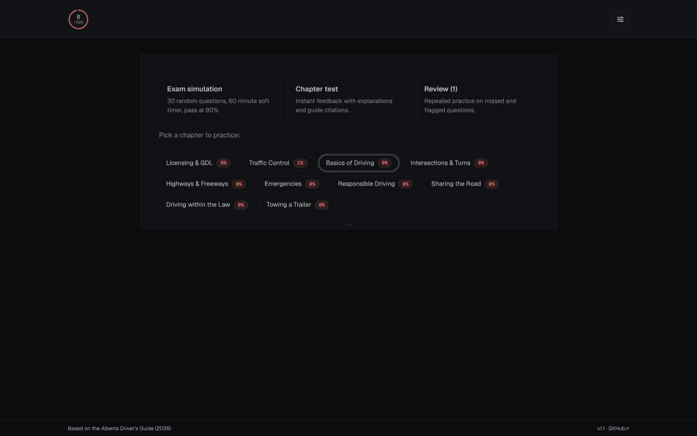
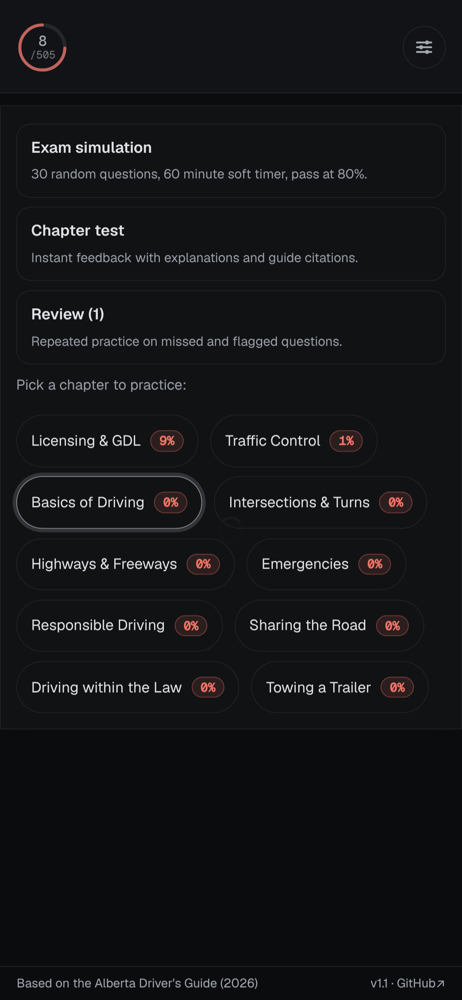

# class7-practice

Practice tests for the **Alberta Class 7 knowledge test** — 505 questions generated
from the official *Driver's Guide to Operations, Safety and Licensing: Cars and
Light Trucks* (Spring 2026), each with an explanation and a citation you can open
in the guide. Runs entirely in your browser.

  
  
Home · practice view on phones is edge-to-edge (see )

## Try it

- **Online — no install:** <https://icyavocado.github.io/class7-practice/>
- **Offline:** download the latest release's `class7-practice-*.zip`, unzip, open `index.html` — it works from `file://`.
- **Local development:** `python3 serve.py` → <http://127.0.0.1:8461/>

## What it does

- **505 questions in 10 chapters**, written as study paraphrases of the guide, with
  per-question explanations and `source` links ("Chapter 2 → Prohibitive signs")
  that open the exact guide section.
- **Chapter confidence** — each chapter pill carries a live percentage
  (green at 100%, amber below 70%, red below 40%, `—` for untouched chapters);
  the weakest chapter is softly ringed as the recommended next practice.
- **Three modes** — Exam simulation (30 random questions, 60-minute soft timer,
  pass at 80%), Chapter test with instant feedback, and Review of missed/flagged
  questions.
- **Named profiles** with separate progress, plus share links / backup files that
  hand your progress to another device.
- **Community signals** — every answered question carries 👍 Good / 👎 Report buttons;
  votes are stored in a Supabase project you configure (schema in `supabase/`),
  and answered questions show a small "endorsed · reported" chip with live counts.
  "Write details…" opens the ready-made GitHub issue form for full reports.
- **No dependencies** — five static files and two fonts; no build step, no framework.

## Your own practice tests (PDF → questions)

Use the app as a skeleton for any study guide:

- **Settings → Practice test → ＋** (or "New practice test from a PDF").
- Drop a **text-based PDF**, review the auto-detected chapters, set how many
  questions per chapter (5/10/20/50 — editable per chapter), and hit **Generate**.
- Questions are written by your own AI provider: pick **OpenAI-compatible**
  (OpenAI, OpenRouter, Groq, local Ollama — base URL + key + model), **Anthropic**,
  or **Gemini**. The key stays on your device and is called directly from your browser;
  costs show up on your provider bill (a few thousand tokens per chapter).
- The generated bank gets its own chapters, tally, progress, and modes — stored
  separately from the built-in Alberta bank; switch or delete it anytime in settings.
- Works on GitHub Pages and from the offline bundle. Generation needs internet +
  a working API key; everything after that is offline. Scanned/image-only PDFs
  (no text layer) aren't supported yet.

## Content & fact-checking

The question bank is derived from the [official guide](drivers-guide-2026.md)
(2026 edition, © Government of Alberta). Every question carries a `source`
section + anchor, and [`tools/factcheck.mjs`](tools/factcheck.mjs) cross-checks
the whole bank against the guide text:

- structure (unique ids, answer index in range, cited pages),
- citations (every anchor resolves to a guide heading),
- content (each keyed answer re-scored against the cited section's text; every
  flag manually adjudicated).

**[Full report →](docs/fact-check.md)** — 8 questions were corrected or replaced
during the first pass, 3 citation anchors repaired, 494 verified unchanged.
A "Report this question" button (after answering) lets readers keep this
honest; the community answered-count and downvote reports land in the
fact-check pipeline.

> ⚠️ This is a study aid, **not** the official test and not legal advice. Rules
> change — always read the current official guide.

## Privacy

Everything lives in your browser (IndexedDB). There is no server, no analytics,
no tracking. Sharing progress encodes it in a URL — optionally shortened via
is.gd (a third-party service, used only when you click "Shorten"). The one
deliberate phone-home is the **Flag this question** button, which opens GitHub
with a prefilled issue — that is on you, not automatic.

## Project structure

| File | Role |
|---|---|
| `index.html`, `styles.css` | static shell + styles |
| `app.js` | all logic (IIFE, no modules, no deps) |
| `questions.js` | the 505-question bank (`window.QUESTIONS`) |
| `store.js` | IndexedDB facade with in-memory fallback (`window.DB`) |
| `drivers-guide-2026.md` | the guide text every question cites |
| `tools/factcheck.mjs` | rerunnable fact-checker → `docs/fact-check.md` |
| `supabase/` | report schema + edge function (answered counts, community votes) |
| `.github/workflows/` | `release` (tag → offline bundle + Pages) |

## Contributing

Found a question that clashes with the guide, or a typo in it? Press
**👎 Report** on an answered question and tell us what's wrong — the report
records your vote and asks for a reason (you can add detail, or skip). Code
PRs welcome: keep it dependency-free and vanilla.

## License

Code: [MIT](LICENSE). Question text and cited guide material: derived from the
Alberta **Driver's Guide to Operations, Safety and Licensing — Cars and Light
Trucks (2026)**, © Government of Alberta. Independent study aid; not affiliated
with or endorsed by the Government of Alberta; verify everything against the
official guide.
