<!-- Generated from tec-drivers-guide-2026.pdf (Government of Alberta, Spring 2026) -->

# Driver’s Guide — Cars and Light Trucks

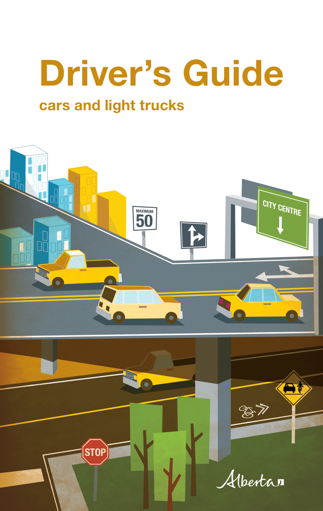

**Government of Alberta · Transportation and Economic Corridors · Spring 2026**

*Source: [alberta.ca driver guides](https://www.alberta.ca/driver-guides-overview-and-pdf-versions.aspx). Text and figures © 2026 Government of Alberta (Open Government Licence – Alberta).*
## Contents

- **[Chapter 1 — Licensing Information](#chapter-1-licensing-information)**
  - [Graduated driver licensing](#graduated-driver-licensing)
  - [Knowledge test](#knowledge-test)
  - [Vision requirements](#vision-requirements)
  - [Class 5 road test](#class-5-road-test)
  - [Types of vehicles for licence class](#types-of-vehicles-for-licence-class)
  - [For hire, driver’s licence requirements](#for-hire-drivers-licence-requirements)
  - [Air brake endorsement (Q)](#air-brake-endorsement-q)
  - [Driver examiner](#driver-examiner)
  - [Driver’s licence](#drivers-licence)
  - [Applying for your Alberta driver’s licence](#applying-for-your-alberta-drivers-licence)
  - [Non-Alberta licenCe for tourists and visitors](#non-alberta-licence-for-tourists-and-visitors)
  - [New Alberta residents](#new-alberta-residents)
  - [Medical requirements](#medical-requirements)
  - [Condition codes and endorsements](#condition-codes-and-endorsements)
  - [Re-classing your licence](#re-classing-your-licence)
  - [Replacing your Alberta driver’s licence](#replacing-your-alberta-drivers-licence)
  - [Renewing your Alberta driver’s licence](#renewing-your-alberta-drivers-licence)
  - [Updating your Alberta driver’s licence](#updating-your-alberta-drivers-licence)
  - [Registration and insurance](#registration-and-insurance)
- **[Chapter 2 — Traffic Control](#chapter-2-traffic-control)**
  - [Traffic control signals](#traffic-control-signals)
  - [Pedestrian signals and signs](#pedestrian-signals-and-signs)
  - [Lane reversal signals](#lane-reversal-signals)
  - [Sign shapes and colours](#sign-shapes-and-colours)
  - [Traffic regulatory signs](#traffic-regulatory-signs)
  - [Traffic direction signs](#traffic-direction-signs)
  - [Speed limit signs](#speed-limit-signs)
  - [Permissive signs](#permissive-signs)
  - [Prohibitive signs](#prohibitive-signs)
  - [School zones and areas](#school-zones-and-areas)
  - [Playground zones and areas](#playground-zones-and-areas)
  - [Parking services for persons with disabilities](#parking-services-for-persons-with-disabilities)
  - [TTY capabilities](#tty-capabilities)
  - [Warning signs](#warning-signs)
  - [Information and guide signs](#information-and-guide-signs)
  - [Other signs](#other-signs)
  - [Construction zones](#construction-zones)
  - [Pavement markings](#pavement-markings)
  - [Shared-use lanes](#shared-use-lanes)
  - [Other roadway markings](#other-roadway-markings)
- **[Chapter 3 — The Basics of Driving](#chapter-3-the-basics-of-driving)**
  - [Pre-drive basics](#pre-drive-basics)
  - [Driving a vehicle with an automatic transmission](#driving-a-vehicle-with-an-automatic-transmission)
  - [Driving a vehicle with a manual (standard) transmission](#driving-a-vehicle-with-a-manual-standard-transmission)
  - [Steering](#steering)
  - [Signalling](#signalling)
  - [Accelerating](#accelerating)
  - [Stopping time and distance](#stopping-time-and-distance)
  - [Reversing](#reversing)
  - [Parking](#parking)
- **[Chapter 4 — Intersections and Turns](#chapter-4-intersections-and-turns)**
  - [Right-of-way](#right-of-way)
  - [Intersections](#intersections)
  - [Keep intersections clear](#keep-intersections-clear)
  - [Turning](#turning)
  - [Turning lanes](#turning-lanes)
  - [U-turns](#u-turns)
- **[Chapter 5 — Highways and Freeways](#chapter-5-highways-and-freeways)**
  - [Lane selection and position in your lane](#lane-selection-and-position-in-your-lane)
  - [Passing](#passing)
  - [Emergency stopping lane](#emergency-stopping-lane)
  - [Entering and exiting a major roadway](#entering-and-exiting-a-major-roadway)
- **[Chapter 6 — Emergency Situations and Challenging Conditions](#chapter-6-emergency-situations-and-challenging-conditions)**
  - [Emergency braking](#emergency-braking)
  - [Loss of control](#loss-of-control)
  - [Vehicle mechanical problems](#vehicle-mechanical-problems)
  - [Challenging conditions](#challenging-conditions)
  - [Emergency supplies](#emergency-supplies)
  - [Animals](#animals)
  - [Collisions](#collisions)
  - [Emergency response vehicles and tow trucks](#emergency-response-vehicles-and-tow-trucks)
  - [Emergency vehicles](#emergency-vehicles)
  - [Maintenance and construction vehicles](#maintenance-and-construction-vehicles)
- **[Chapter 7 — Responsible Driving](#chapter-7-responsible-driving)**
  - [Proactive driving](#proactive-driving)
  - [Securing passengers](#securing-passengers)
  - [Fuel efficiency and helping our environment](#fuel-efficiency-and-helping-our-environment)
  - [Traffic laws](#traffic-laws)
- **[Chapter 8 — Sharing the Road](#chapter-8-sharing-the-road)**
  - [Vulnerable road users](#vulnerable-road-users)
  - [Commercial vehicles](#commercial-vehicles)
  - [Log hauling vehicles](#log-hauling-vehicles)
  - [School buses](#school-buses)
  - [Snowplows](#snowplows)
  - [Railway crossings](#railway-crossings)
  - [Vehicles carrying passengers or dangerous goods](#vehicles-carrying-passengers-or-dangerous-goods)
  - [Light rail transit](#light-rail-transit)
  - [Off-highway vehicles](#off-highway-vehicles)
  - [Funeral processions](#funeral-processions)
- **[Chapter 9 — Driving within the Law](#chapter-9-driving-within-the-law)**
  - [Driver fitness](#driver-fitness)
  - [Driving responsibly](#driving-responsibly)
  - [Driving laws](#driving-laws)
  - [Driver’s licence suspensions and disqualifications](#drivers-licence-suspensions-and-disqualifications)
  - [SafeRoads Alberta](#saferoads-alberta)
  - [Registrar Reconsideration Process](#registrar-reconsideration-process)
- **[Chapter 10 — Towing a Trailer](#chapter-10-towing-a-trailer)**
  - [Registration and licence plate](#registration-and-licence-plate)
  - [Equipment](#equipment)
  - [Towing a trailer](#towing-a-trailer)

---

*Driver’s Guide*

*Spring 2026*

*For more information about this publication, contact: Driver Programs Branch, Transportation and Economic Corridors First Floor, Twin Atria Building 4999 98 Avenue Northwest, Edmonton, Alberta T6B 2X3 Email: tec.licensingtraining@gov.ab.ca*

*©2026 Government of Alberta This document is made available under the Open Government Licence – Alberta ([https://open.alberta.ca/licence](https://open.alberta.ca/licence)).*

*This document is available at: [https://www.alberta.ca/driver-guides-overview-and-pdf-](https://www.alberta.ca/driver-guides-overview-and-pdf-) versions.aspx.*

*Cette publication est également offerte en français sous le titre « Guide du conducteur – Conduite, sécurité et délivrance de permis – Automobiles et camions légers ».*

# Driver’s Guide
## cars and light trucks

## Introduction

When you are in the driver’s seat, a whole new world opens to you. For drivers of all ages, getting a driver’s licence can be a rite of passage, providing opportunities for employment, mobility, and independence.

Driving involves responsibility and risk. The following are the key skills you must develop to prepare yourself for this responsibility.

**Attitude:**

Develop an attitude of safe and responsible driving every time you drive.

**Awareness:**

Be aware of what is happening around you as you drive, and always make responsible decisions about hazards and problems.

**Knowledge:**

Learn and understand traffic laws and rules of the road.

**Skill:**

Enrol in driver education programs to learn more about operating a motor vehicle safely.

It takes education, training, and practice to develop this awareness, knowledge, and skill. Your attitude shows in the decisions you make about being a responsible driver. Be courteous with other road users. Always drive proactively.

Along with all the benefits that motor vehicles provide, there are also costs. Beyond the direct costs of building and maintaining our roadways, there are environmental and human costs. Most collisions can be prevented.

Transportation and Economic Corridors recommends that you obtain training and education from a licensed driving school to enhance your knowledge and skill. Driver education courses are available for the operation of passenger vehicles, commercial vehicles, and motorcycles.

If you require information about schools that provide driver education, or information about the testing process to obtain a driver’s licence: visit [www.alberta](https://www.alberta). ca/driving-vehicles.aspx

## Guides available

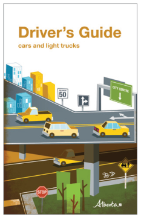

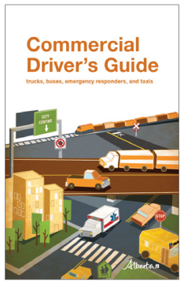

The following guides provide information about the safe operation of cars and light trucks, commercial vehicles, and motorcycles, and the licensing of drivers and riders. These guides provide information for all classes of driver’s licences in Alberta, and will help you obtain an Alberta driver’s licence. Consider keeping the guides in your vehicle as a reference.

**Driver’s Guide**

Cars and Light Trucks

This guide provides information for all drivers.

**Commercial Driver’s Guide**

Trucks, Buses, Emergency Responders, and Taxis

This guide provides information about driving commercial vehicles. It is used with the Driver’s Guide. Both of these guides should be used when preparing for a commercial knowledge test and when learning to operate trucks,

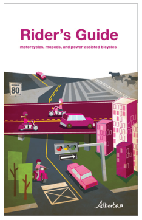

emergency response vehicles, taxis, and buses, as well as when handling dangerous goods. Commercial knowledge tests are comprised of questions based on the entirety of the Driver’s Guide and Commercial Driver’s Guide, regardless of chapter title.

**Rider’s Guide**

Motorcycles, Mopeds, and Power- Assisted Bicycles

This guide provides information on the safe operation of motorcycles, mopeds, and power-assisted bicycles. It is used with the Driver’s Guide.

The information in these guides explains best practices for driving a vehicle, but cannot cover all circumstances. You must use judgement and a safety-first attitude to make decisions in real on-road situations.

These guides interpret the laws that govern the movement of vehicles and people on Alberta roadways. They are guides only and have no legal authority.

The laws that apply to driving a vehicle can be found in the *Traffic Safety Act* and its related regulations, available at kings-printer.alberta.ca and:

King’s Printer Bookstore Suite 700, Park Plaza 10611–98 Avenue Edmonton, Alberta T5K 2P7

Tel: 780–427–4952 Fax: 780–452–0668

For toll free service anywhere in Alberta, call 310–0000, then the number.

### For more driver and vehicle information

Knowledge tests are conducted at registry agent offices. Road tests must be conducted only by persons designated by the Government of Alberta as driver examiners. Road tests can be scheduled in-person at a registry agent office or online through the government online scheduling system.

To access information on testing services, driver licensing, and registering vehicles:

- visit [www.alberta.ca/drivers-road-test.aspx](https://www.alberta.ca/drivers-road-test.aspx)
- visit [www.alberta.ca/lookup/find-a-](https://www.alberta.ca/lookup/find-a-) registry-agent.aspx
- visit the Association of Alberta Registries at [www.e-registry.ca](https://www.e-registry.ca)
- call Service Alberta at 780-427-7013

# Chapter 1 — Licensing Information
## Graduated driver licensing

Regardless of age, all new drivers are part of the Graduated Driver Licensing (GDL) program. This program ensures new drivers get the support, skills, and experience they need to handle the complex task of driving. GDL improves road safety by creating a safe and controlled environment for all new drivers.

As a GDL driver, you will hold one of the following driver’s licences:

- Stage One: Class 7 (Learner’s Licence)
- Stage Two: Class 5-GDL (Probationary Licence) The following information highlights the key features of the Learner and Probationary stages of the GDL program.

### Stage 1: Learner (Class 7)

To obtain a Class 7 learner’s licence you must:

- be 14 years of age or older
- pass a vision screening
- pass a knowledge test on the rules of the road

- have parental consent if you are under 18 years of age

- have valid identification.
**Learner’s conditions:**

- You must hold a learner’s licence (Class 7) for at least one year.
- You must be accompanied by a fully-licensed (non-GDL) driver who is 18 years of age or older and is seated next to you.
- You are not permitted to drive from midnight to 5 a.m.
- You are not permitted to have more passengers than seat belts.
- You will be suspended if you accumulate eight or more demerit points.
- You must have a zero alcohol and/ or drug level when driving (or riding a motorcycle).
### Stage 2: GDL Probationary (Class 5-GDL)

To become a probationary driver you must:

- hold your Class 7 leaner’s licence for a year (this time will be extended if you receive a suspension of your driving privileges)

- be 16 years of age or older
- pass the Alberta Class 5 road test.
**Probationary conditions:**

- You must be a probationary driver for a minimum of two years.
- You must have no more passengers than seat belts.
- You will be suspended if you accumulate eight or more demerit points.
- You must have a zero alcohol and/or drug level when driving.
- You are not able to re-class your licence to a commercial driver’s licence (Class 1, 2, 3, or 4).
- You cannot serve as a supervising driver to a learner.
### Stage 3: Full Class 5 (non-GDL)

To exit the GDL program you must:

- be at least 18 years of age
- be in the probationary stage for a minimum of two years

- be free of suspensions or traffic violations within the last 12 months of the probationary stage, including zero alcohol and/or drug level when driving.

You can reduce your probationary stage by up to six months, if:

- you successfully complete an approved driver training course resulting in a condition code (U) being added to your driving record
- all other eligibility requirements are met.
Upon exiting the GDL program, you will:

- move from a Class 5-GDL to a full Class 5 driver’s licence
- qualify to re-class to a Class 1, 2, 3, or 4 driver’s licence
- increase the number of demerits you are allowed
- remove the zero alcohol and drug tolerance condition
- be able to be an accompanying driver to a learner.
## Knowledge test

To obtain your learner’s licence, you will need to pass a knowledge test. You can take your knowledge test at most Alberta registry agent offices. The test is based on questions taken from this guide. You will be asked about safe driving practices, driving laws, and road signs. The test is a series of multiple choice questions and you must score a certain number of correct responses to pass the test. You will do the test on a computer.

When you pass the knowledge test you must take the knowledge test permit you purchased to do the test to a registry agent to ensure your driver’s licence is updated.

The Class 7 electronic driver knowledge test is available in the following 25 languages:

- Amharic
- Portuguese
- Arabic
- Punjabi
- Chinese (Simplified)
- Russian
- Chinese (Traditional)
- Somali
- Cree
- Spanish
- Dutch
- Tagalog
- English
- Thai
- Farsi
- Ukrainian
- French
- Urdu
- German
- Vietnamese
- Hindi
- Italian
- Korean
- Oromo
- Polish There is a fee for each knowledge test that you take, and you can take only one test per day.

## Vision requirements

A vision assessment is required before you are eligible to obtain an Alberta driver’s licence. If you do not meet the vision standards, you will be referred to an optometrist or an ophthalmologist to have a Vision Referral form completed. If you have corrective glasses or contact lenses, bring them with you for your vision assessment.

## Class 5 road test

Class 5 is the most commonly held driver’s licence, allowing drivers to operate cars and other light vehicles.

Passing the Class 5 road test allows drivers to move from a Class 7 learner’s licence to a Class 5-GDL driver’s licence. This test determines whether a learner has developed the necessary driving skills such as safe vehicle handling, judgement, and knowledge of the rules of the road to become a Class 5-GDL probationary driver.

When you pass the Class 5 road test you must take the road test permit you purchased to do the test to a registry agent to ensure your driver’s licence is updated. The road test permit is not a driver’s licence.

This road test is approximately 45 minutes. This will include the driver examiner’s pre-test instructions and summary of your results. You will be required to demonstrate the ability to operate your vehicle safely without supervision while interacting with other road users.

The vehicle for your road test must be in acceptable working condition and must have the following:

- a valid licence plate and insurance
- headlights, brake lights, and signal lights
- horn
- speedometer
- brakes/park brake
- unobstructed windshield/wipers
- tires are in good condition
- driver and passenger doors
- vehicle seats/seat belts
- exhaust system/muffler
- mirrors
- enough fuel for a road test.
The test will include identifying and operating your vehicle’s controls. This includes:

- handling the vehicle (steering, braking, and speed control)
- selecting the proper lane for turns
- observing and obeying speed zones
- determining right-of-way at intersections and while changing lanes
- demonstrating knowledge and skill at intersections with and without sign and signal controls
- interacting with other road users in a non-obstructive manner
- parking – perpendicular, uphill, or downhill parking, and parallel (drivers over 65 are not required to complete a parallel park).
### Some common reasons for not passing the road test

Drivers earn points for mistakes made during a road test, with a set limit for each test. If the maximum points for errors are exceeded, the driver fails the test. Regardless of point totals, the following actions result in automatic failure:

- Exceeding the speed limit or driving too fast for the conditions.
- Failing to stop completely before proceeding through an intersection controlled by a stop sign, or before turning right on a red light.
- Failing to yield the right-of-way at an intersection or during a lane change.
- Obstructing traffic by driving too slowly or stopping unnecessarily.
- Climbing over the curb while parking, or being unable to park legally in three attempts.
- Failing to slow or observe adequately at uncontrolled intersections (you must be prepared to yield to drivers to your right).
### To update your driver’s licence after

passing a road test, take the road test permit to a registry agent. The road test permit is not a driver’s licence.

## Types of vehicles for licence class

### Class 7 (GDL)

A person 14 years of age or older may apply for a learner driver’s licence.

A parent or guardian must give consent on the application if the person applying is under 18 years of age. For learning and while accompanied by a fullly-licensed driver, the holder of a Class 7 driver’s licence may operate the following:

- a vehicle or vehicle-trailer combination that the holder of a Class 5 driver’s licence may operate
- a motorcycle (must be 16 years of age or older when learning with a supervisor who holds a Class 6 non-GDL licence)
- a moped.
### Class 5-GDL

The minimum licensing age is 16 years.

Anyone under the age of 18 years applying for a driver’s licence must have parental or guardian consent.

The holder of a Class 5-GDL driver’s licence may operate the following:

- a vehicle or vehicle-trailer combination that the holder of a Class 5 driver’s licence may operate.
### Class 5 non-GDL

The minimum licensing age is 18 years. The holder of a Class 5 non-GDL driver’s licence may operate the following:

- a vehicle or vehicle-trailer combination that the holder of a Class 5 driver’s licence may operate.
**Vehicles that may be operated with a** **Class 5 driver’s licence:**

- a vehicle with only two axles
- a recreational vehicle with not more than three axles
- a vehicle with only two axles while that vehicle is towing a trailer with one or more axles, and is not equipped with air brakes
- a recreational vehicle with only two axles while that vehicle is towing a trailer with one or more axles, and the trailer is not equipped with air brakes
- a recreational vehicle with three axles while that vehicle is towing a trailer that has one or two axles and is not equipped with air brakes
- a moped
- all motor vehicles included under Classes 1, 2, 3, and 4 for learning. The learner must be at least 18 years of age and have a supervisor with a valid driver’s licence for the type of vehicle
- a motorcycle (for learning with a supervisor who holds a Class 6 non-GDL licence).
The holder of a Class 5 driver’s licence shall not operate:

- a motorcycle (unless for learning)
- a vehicle with a seating capacity of more than 15 while that vehicle is transporting any person other than the driver
- a vehicle transporting passengers for hire
- a vehicle equipped with air brakes, unless the supervisor has an air brake endorsement.
## For hire, driver’s licence requirements

A Class 4 driver’s licence is required when the vehicle owner or operator, or the operator’s employer, is being paid for the service that the vehicle is being used to provide.

A Class 4 driver’s licence is NOT required when the vehicle owner or operator, or the operator’s employer, drives a private passenger vehicle for the transportation of passengers on an incidental or occasional basis and receives compensation for:

- payment for the kilometres travelled
- straight reimbursement for out-of-pocket expenses directly related to the transportation such as gas, parking, gate passes and tolls, or when the vehicle operator is party to an agreement to provide transportation for compensation only to:
· the operator’s family members

· members of the operator’s household

· persons for whom the operator is a legal guardian.

## Air brake endorsement (Q)

When a person successfully completes an approved Alberta air brake course through an authorized agency, an air brake endorsement (Q) will be placed on that driver’s licence.

An air brake endorsement is required for drivers of vehicles with:

- an air-only braking system, or
- a combination of air and hydraulic braking system.
More information on the air brake course is available online at: [www.alberta.ca/air-](https://www.alberta.ca/air-) brake-program.aspx

## Driver examiner

Driver examiners are responsible for ensuring only qualified individuals receive a driver’s licence. Road tests must be conducted only by persons designated by the Government of Alberta as driver examiners.

Registry agent offices are the primary sites for road tests to begin and end. On a road test, no passengers or pets are allowed. An exemption to this is when an examiner is accompanied by a government official during a training or monitoring session.

Class 4, 5, and 6 road tests are delivered by licensed driver examiners through Alberta registry agents on behalf of the Government of Alberta. Licensed driver examiners are trained, licensed, monitored, and audited by the government. Road tests can be scheduled through an Alberta registry agent.

Class 1, 2, and 3 commercial road tests are conducted by Government of Alberta driver examiners and can be scheduled through an Alberta registry agent or online

through the online scheduling system.

More information on road tests is available online at: [www.alberta.ca/drivers-](https://www.alberta.ca/drivers-) road-test.aspx

## Driver’s licence

A driver’s licence is required to operate a motor vehicle and is issued pursuant to the *Traffic Safety Act*. A person shall not drive a motor vehicle on a highway unless that person’s driver’s licence is in that person’s possession. On the request of a peace officer, a person driving a motor vehicle shall produce their subsisting driver’s licence, insurance, and registration. Ensure that these documents are with you every time you operate a motor vehicle.

## Applying for your Alberta driver’s licence

Driver licensing services are provided through the Alberta registry agent network.

When applying for an Alberta driver’s licence you must provide identification.

For information on identification requirements visit: [www.alberta.ca/id-](https://www.alberta.ca/id-) requirements-for-identification-cards.aspx

A driver’s licence may only be issued to residents of Alberta. A resident is a person lawfully entitled to be in Canada, who makes their home in Alberta and is ordinarily present in Alberta.

Applicants originating from outside Canada or the United States must produce suitable immigration documents to be considered as residents.

### Parental consent requirement

Minors (under 18) applying for a driver’s licence for the first time must have a parent or legal guardian accompany them to a registry office, show proof of guardianship, and sign a consent form. The guardian has the right to revoke their consent in writing until the minor turns 18. If revoked, the licence will be suspended. A parent/guardian signature is not needed if the minor provides proof of marriage or self-support.

## Non-Alberta licenCe for tourists and visitors

Visitors to Alberta with a valid out-of-province licence or permit for a specific vehicle class are allowed to drive the same class of vehicle in Alberta without obtaining a local licence for up to one year.

## New Alberta residents

### From other places in Canada

New Alberta residents may use their out-of-province driver’s licence for the first 90 days of residency. They must apply for an Alberta driver’s licence and surrender their out-of-province licence within those 90 days. It is illegal to hold more than one driver’s licence.

Depending on the class of licence, driver’s licence equivalency restrictions may apply to individuals exchanging a driver’s licence from another jurisdiction within Canada.

Applicants for Class 1, 2, or 4 licences must provide a medical report and pass a vision screening.

For more information on exchanging a licence from another province, visit: www. alberta.ca/exchange-non-alberta-licences. aspx

### From the United States

Licence holders from the United States, other than those holding Class 5, 6, or 7, must complete all requirements.

You must present proof-of-residency documents when applying. For details, inquire at your local registry agent office.

### Jurisdictions with reciprocal licensing agreements

Alberta currently has reciprocal licensing agreements with the following jurisdictions:

- Australia (Class 5 and 6)
- Austria (Class 5)
- Belgium (Class 5)
- France (Class 5)
- Germany (Class 5)
- Isle of Man (Class 5 and 6)
- Japan (Class 5)
- Netherlands (Class 5)
- Republic of Ireland (Class 5 and 6)
- Republic of Korea (Class 5)
- Switzerland (Class 5 and 6)
- Taiwan (Class 5)
- United Kingdom (Northern Ireland – Class 5 and 6)
- United Kingdom (England, Scotland, and Wales – Class 5).
A valid licence from a jurisdiction that has a reciprocal licensing agreement with Alberta can be exchanged for a Class 5 licence when the applicant presents a valid licence of equivalent class.

All other licence classes require testing and vision screening. The applicants must disclose all medical conditions and physical disabilities that may affect their ability to safely operate a motor vehicle. All applicants must produce immigration and residency documentation along with acceptable identification.

### Jurisdictions without reciprocal licensing agreements

A person coming to Alberta from outside Canada may apply to have their previous driving history credited to their Alberta driving record. A successful application will grant exemption from the GDL program and allow for Class 5 road testing without being required to hold a Class 7 learner’s licence for one year. More information about the process for exchanging a licence from a non-reciprocal jurisdiction is available at any registry agent office.

### Students

A student is not required to obtain an Alberta driver’s licence when operating a motor vehicle if the following apply:

- The student is authorized to operate a motor vehicle of the same type or class by the laws of the jurisdiction in which the student ordinarily resides.
- The documents required by the laws of the jurisdiction where the student ordinarily resides are carried by the student or are in the vehicle.
- The student must carry proof showing that they are a full-time student in this province.
## Medical requirements

Under the Operator Licensing and Vehicle Control Regulation, you must disclose any medical or physical condition that could affect your ability to safely operate a motor vehicle.

Examples include: diabetes, seizure disorders, heart or respiratory conditions, cognitive or neurological impairments, musculoskeletal or psychiatric conditions, sleep disorders, or loss of mobility/limbs. If you have such a condition, you must submit a Driver Medical Intake Form.

- Forms are available from an Alberta registry agent office, your doctor, or a nurse practitioner.
- The form must be completed by a doctor or nurse practitioner.
- Completed forms must be returned to an Alberta registry agent office or emailed to the Driver Medical Fitness Program (driver.fitness@gov.ab.ca).
### Additional requirements for drivers aged 75 or older

- When applying for or renewing a Class 7, 6, 5, or 3 licence, you must provide a completed Driver Medical Intake Form.
- Your vision will also be assessed at an Alberta registry agent office.
### General requirements for all drivers

- You must provide medical documentation when requested, regardless of age, to confirm your fitness to drive.
- A basic road test or additional assessments may be required if there are concerns about your medical fitness.
- Review your medical fitness regularly and comply with reporting requirements to maintain your driving privileges.

### Key Repercussions of Non-Compliance

**Licence Suspension or Refusal**

- If you don’t submit a Driver Medical Intake Form when required, your licence renewal or application can be denied.
- Transportation and Economic Corridors may suspend your existing licence until medical documentation is provided.
**Legal Liability**

- Driving without disclosing a medical condition that affects safety can expose you to liability if you’re involved in a collision. Courts may consider non-disclosure as negligence.
**Public Safety Concerns**

- Conditions like dementia, seizure disorders, or severe heart disease significantly increase crash risk.
- Alberta’s medical reporting rules are designed to protect both you and other road users.
## Condition codes and endorsements

### Condition codes

A condition code may be added to a driver’s licence to indicate special requirements. For example, all drivers must meet specific vision requirements to operate a vehicle. If you require glasses or contact lenses to improve your vision to meet these standards, you will have a condition code on your driver’s licence indicating this requirement. Some drivers may require a medical examination by a doctor or a nurse practitioner, which would also be indicated by a condition code.

In more extreme situations, a change in a person’s situation can make it impossible to safely operate a vehicle. These situations are not common, but do mean that the person is not able to be licensed to operate a vehicle.

### Endorsement codes

An endorsement code on a driver’s licence shows that the person has had specific education or training, such as completing a novice driver education course or a course specific to operating a school bus. An endorsement may also indicate that the person is permitted to drive a vehicle that has a specific feature, such as a vehicle with air brakes.

Each condition or endorsement corresponds to a letter code which may be shown on the driver’s licence. Conditions and endorsements specific to you are placed on the front of the licence, in the Cond/End section. Some of the condition codes and endorsements have an explanation on the back of the driver’s licence.

**Driver licence condition codes:**

- **A** — Adequate Lenses

- **B** — Special Conditions
- **C** — Periodic Medical\*
- **D** — Periodic Vision Report\*
- **E** — Periodic Driver Examination\*

- **F** — Valid Temporary Licence

- **G** — Temporary Resident 
- **H** — Daylight Driving Only
- **J** — Outside Mirrors

- **K** — Automatic Transmission
- **L** — Hand Controls

- **M** — Under Transportation and Economic Corridors Review\*

- **N** — Excludes Class 2 and 4
- **P** — Testing to be conducted by Provincial Examiner only\*

- **T** — Special Medical\*

**Driver licence endorsements:**

- **Q** — Air Brakes
- **S** — School Bus

- **V** — Extended Length Vehicle Combinations

- **U** — Completed Driver Education Course\*

*\*Do not appear on the driver’s licence*

## Re-classing your licence

When re-classing your driver’s licence (excluding Class 7 to Class 5), you must present proof that you have completed a knowledge test and vision test through a registry agent office.

Re-classing your driver’s licence from your current class to a Class 1, 2, or 4 licence will also require a medical report. See the medical requirements section for more information.

A fee is charged for each knowledge test, road test, and for the final licence re-classification service.

For information knowledge test fee, visit: [www.alberta.ca/drivers-knowledge-test.aspx](https://www.alberta.ca/drivers-knowledge-test.aspx)

For information on road test fee, visit: [www.alberta.ca/drivers-road-test.aspx](https://www.alberta.ca/drivers-road-test.aspx).

Driving with the wrong licence class is against the law. It is an offence for vehicle owners to allow their vehicle to be used by someone who does not have the proper class of licence for that vehicle.

## Replacing your Alberta driver’s licence

If your driver’s licence is lost, stolen, destroyed, or is unreadable, you must apply for a replacement immediately at a registry agent office.

If your driver’s licence is stolen, you must report it to the police, and provide a copy of the police report to the registry agent when you apply for your replacement.

## Renewing your Alberta driver’s licence

The Government of Alberta has stopped mailing out reminders about driver’s licences and vehicle registration. Albertans with disabilities will continue to receive reminders in the mail. Albertans can sign up for electronic reminders by visiting E-registry or MyAlberta and signing up for free reminders. It is your responsibility to renew your driver’s licence on or before the expiry date.

## Updating your Alberta driver’s licence

To change the information on your driver’s licence, such as your name, address, or licence class, visit an Alberta registry agent office.

You are required by law to ensure the information on your licence is current and accurate. You may be required to provide proper identification before any change, replacement, or renewal can be made.

To replace, renew, or update your Alberta driver’s licence, contact a registry agent by visiting: [https://www.alberta.ca/lookup/find-a-registry-agent.aspx](https://www.alberta.ca/lookup/find-a-registry-agent.aspx)

## Registration and insurance

### Registration

Motor vehicles and trailers travelling on Alberta roadways must be registered.

Registration certificates cannot be issued to anyone under the age of 18 years, unless the application for registration is also signed by a parent or guardian. A parent or guardian has the right to withdraw consent in writing at any time. If consent is withdrawn, the licence plate and vehicle registration will be suspended. The signature of your parent or guardian is not required if you can prove you are married or self-supporting.

In Alberta, licence plates remain with the owner of the vehicle and are not transferable to another person.

A vehicle owner must register their vehicle within three months of moving to Alberta.

### Insurance requirements

All motor vehicles must be insured with a public liability insurance policy as outlined in the Alberta *Insurance Act*.

It is illegal to operate an uninsured motor vehicle.

Your insurance company issues a financial responsibility card (pink card) which must be presented when registering a vehicle and when requested by a peace officer.

# Chapter 2 — Traffic Control
## Traffic control signals

Traffic control signals are lights that use the colours green, yellow, and red to control the flow of traffic at intersections or where roadways merge. The colour of the light determines which stream of traffic has the right-of-way. The traffic control signal may be vertical or horizontal.

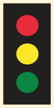

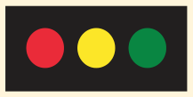

*The order of lights for a horizontal traffic control signal is red on the left, yellow in the centre, and green on the right.*

*The order of lights for a vertical traffic control signal is red at the top, yellow in the centre, and green at the bottom.*

Solid red light:

Drivers facing a traffic control signal displaying a solid red light must bring their vehicles to a complete stop before the stop line or crosswalk that is directly in front of the vehicle. If there is no stop line or crosswalk, drivers must stop before the intersection. Vehicles must remain stopped at the red light until it turns green, unless safely turning right after stopping.

A solid double red light has the same meaning as a single red light.

Turning right at a red light is permitted provided that there is no sign prohibiting the turn. Before making the turn the vehicle must come to a complete stop before the stop line or crosswalk. Complete the turn when it is safe to do so while yielding to any other traffic.

Unless a sign prohibits the turn, the only left turn permitted at a red light is onto a one-way street from a one-way street. This turn is only permitted after the vehicle is brought to a complete stop before the stop line or crosswalk, and if the turn can be made safely after yielding to other traffic.

**Solid yellow light:**

When a green light changes to yellow, it warns that the light will change to red immediately and drivers must prepare to stop or clear the intersection. Drivers approaching an intersection with a solid (not flashing) yellow traffic control light must bring their vehicles to a complete stop before the stop line or crosswalk, unless a point has been reached at the intersection where stopping cannot be done safely. If there is no stop line or crosswalk, vehicles must stop before the intersection.

Drivers already in the intersection and facing a yellow light must safely clear the intersection.

**Solid green light:**

Drivers facing a solid green traffic control light are permitted to travel through the intersection without stopping, unless required to yield to oncoming traffic when turning left or to pedestrians in the crosswalk when turning right or left.

When approaching a green light, anticipate that it will turn yellow. A “stale” green light means the light has been green for a while and will turn yellow soon. A good tip is to check the

pedestrian walk light at the intersection. If it shows the “WALK” symbol, the light will stay green. If it shows the “DON’T WALK” symbol, be ready to stop. If the traffic light does change, the driver must stop before the intersection if it can be done safely.

**Green arrow with green light:**

Drivers facing a traffic control light with a green arrow and solid green traffic control light may enter the intersection and proceed without yielding in the direction indicated by the arrow. Drivers facing the green light may also proceed in the other directions when it is safe and legal.

**Green arrow with red light:**

Drivers facing a traffic control light with a green arrow and a red control light may enter the intersection and proceed without stopping only in the direction indicated by the arrow.

**Flashing red light:**

Drivers facing a flashing red traffic control light must stop before the stop line or crosswalk. If there is no stop line or crosswalk, drivers must stop before the intersection. Drivers should proceed only when it is safe and after yielding the right-of way. The flashing red light is treated like a stop sign.

When the lights in all directions are flashing red the intersection becomes a four-way stop.

**Flashing yellow light:**

Drivers facing a flashing yellow traffic control light may proceed with caution after yielding to pedestrians and other vehicles within the intersection.

**Flashing green light:**

Drivers facing a flashing green traffic control light are permitted to go through, turn left or turn right without stopping. Opposing traffic will be facing a red light; however a driver must still yield to pedestrians or other vehicles lawfully in the intersection.

## Pedestrian signals and signs

Drivers must understand pedestrian control lights so they can anticipate the actions of those sharing the road. Pedestrians facing a traffic control signal where a word or symbol indicating “WALK” is displayed, may enter the crosswalk or roadway when it is safe, and proceed in that direction.

A pedestrian facing a traffic signal where a word or symbol indicates “DON’T WALK” must not enter the crosswalk or roadway. Pedestrians who have begun crossing when the word or symbol appears may continue crossing and clear the crosswalk. Some pedestrian signals include a countdown timer to show how much time remains before the light changes.

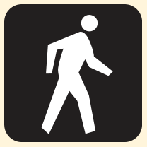

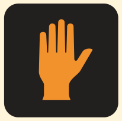

*Pedestrian signal indicating “DON’T WALK” or “WAIT”*

*Pedestrian signal indicating “WALK”*

Yellow lights on a sign with a symbol indicate that caution is required because of school zones or areas, playground zones or areas, school crossings, and pedestrian crossings. When the yellow lights are flashing, the driver must reduce speed to a maximum of 30 km/h and yield or stop for pedestrians.

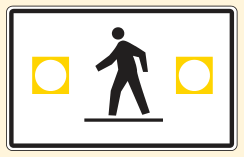

*Pedestrian crossing signs with yellow lights.*

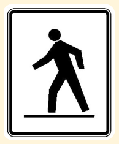

*Pedestrian crossing signs without yellow lights.*

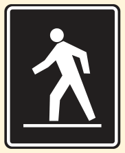

*Special crosswalk overhead sign.*

At intersections with traffic control signals, but without pedestrian “WALK” and “DON’T WALK” signals, pedestrians must obey the rules for the colour of light they are facing.

- Solid red light. Do not enter the intersection.
- Solid yellow light. Clear the intersection if already crossing, or do not enter the intersection.
- Solid green light. Proceed across the road within any marked or unmarked crosswalk.
Pedestrians should check for vehicles before starting to cross.

## Lane reversal signals

Lane reversal signals are used to control the direction of traffic on specific lanes of a roadway. A common use of this control is reversible lanes that change the flow of traffic during different times of the day. The signal(s) over one or more lanes change between a red X and a green arrow.

**Solid red X:**

When a red X is displayed over a driving lane, the driver does not enter or remain in that lane. This signal indicates that the lane is being used by oncoming traffic. Move safely into a lane with a green arrow.

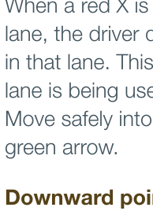

**Downward pointing green arrow:**

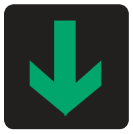

A driver facing the downward pointing green arrow is permitted to travel in that lane.

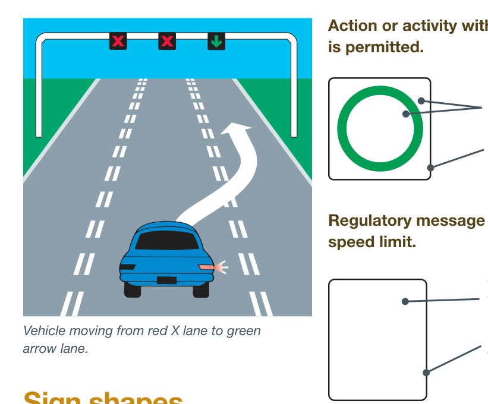

## Sign shapes and colours

The word or symbol on traffic regulation signs tell the driver what can or cannot be done at a specific location or time, and provide information. The shape and colour will vary depending on the type of message.

Traffic regulation signs include those that show right-of-way and road access that is permitted or prohibited. They also show control of speed, turns, direction of travel, passing, traffic lanes, parking, and crosswalks.

**Action or activity within the circle is** **not permitted.**

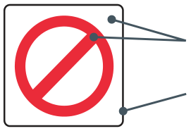

*Red circle and slash on white background*

*Square shape*

*Green circle on white background*

*Square shape*

*Regulatory message on white background*

*Rectangle shape*

**Indicates school zone/area.**

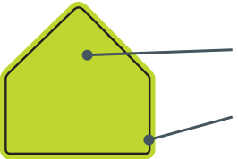

*Fluorescent yellow green background*

*Pentagon shape*

**Indicates lane control.**

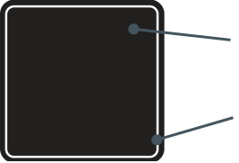

*White message on black background*

*Square shape*

**Provides construction area** **information.**

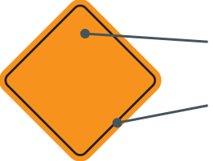

*Information or picture on orange background Diamond shape*

**Provides information such as** **distance to destination.**

*White message on green background*

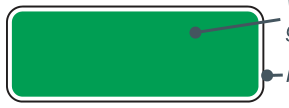

*Rectangle shape*

**Indicates place for fuel, food, lodging,** **or assistance.**

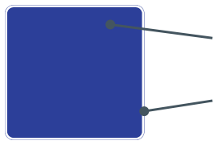

*White message on blue background*

*Square shape*

**Indicates transportation services** **such as air port, ferry, etc.**

*Information or pictures on green background*

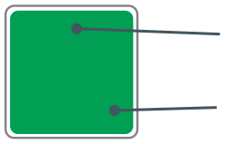

*Square shape*

**Indicates caution or warning of** **hazard displayed on sign.**

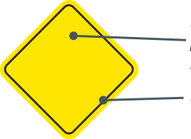

*Information or pictures on yellow background*

*Diamond shape*

## Traffic regulatory signs

**Stop:**

Come to a complete stop and do not proceed until safe.

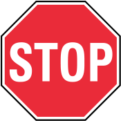

**Yield:**

Yield the right-of-way to traffic not facing the sign and to all pedestrians waiting to cross and within the crosswalk or intersection.

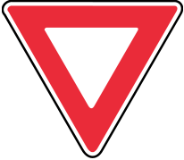

**Wrong way:**

Indicates traffic is moving in an oncoming direction.

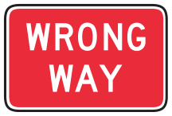

**Do not enter:**

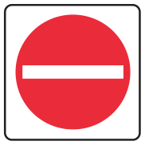

**Railway crossing:**

**Do not stop on tracks:**

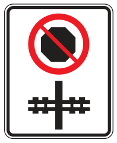

## Traffic direction signs

**Proceed in direction** **of arrow only:**

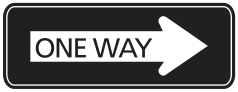

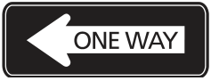

**Two way traffic:**

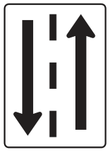

**Divider ahead – keep right:**

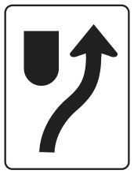

## Speed limit signs

Speed limits do not indicate the maximum speed drivers should travel. They are the maximum speed permitted when conditions are ideal. Any speed that is unsafe for the current conditions is illegal.

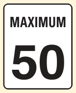

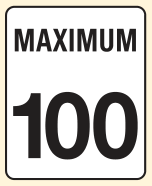

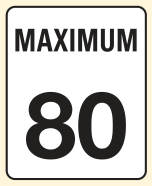

*Speed limit signs are in kilometres per hour (km/h).*

Unless otherwise posted:

- 100 km/h is the maximum speed limit on a provincial highway located outside an urban area.
- 80 km/h is the maximum speed limit on a provincial highway located inside a corporate limit of a city.
- 80 km/h is the maximum speed limit on a roadway that is located outside an urban area.

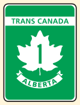

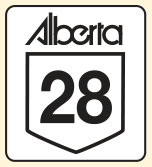

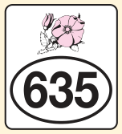

*A provincial highway is identified by either a single-digit, two-digit or three-digit highway route marker.*

A local road generally would not have a route marker but could be identified by a name, such as Irricana Road, a township road, such as TWP RD 52, or a range road, such as RGE RD 252.

- 50 km/h is the maximum speed limit on a roadway that is located within an urban area, unless otherwise posted.
***Note****: Municipalities may have bylaws* *on speed limits that place maximum* *limits different than the information* *presented here. Be aware of local laws* *and pay attention to all signage and* *posted speed limits.*

### Designated lane signs

The message or symbol on these signs indicates the direction(s) a vehicle must travel in the lane.

**Right turn:** **Left turn:**

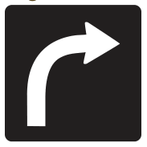

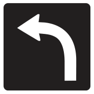

**Straight or** **Straight or** **right turn:** **left turn:**

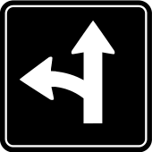

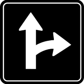

**Straight** **Left turn** **only:** **lane control:**

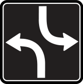

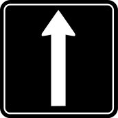

**Single lane roundabout:**

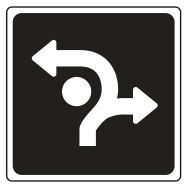

Some intersections allow more than one vehicle travelling in the same direction to turn at the same time. Maintain your lane position during and after the turn.

**Dual right turn:** **Dual left turn:**

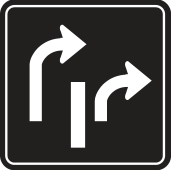

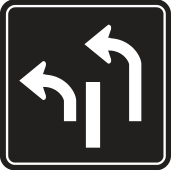

**Left lane turn left,** **right lane straight** **or turn left:**

**Left lane turn** **left, right lane** **straight:**

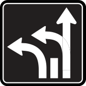

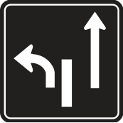

**Left lane turn** **left, centre lane** **straight, right** **lane straight** **or turn right:**

**Roundabout** **dual lane:**

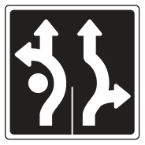

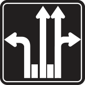

Indicated lanes are reserved for specific vehicles such as buses, taxis, and bicycles. The symbol on the sign will identify the vehicles permitted to travel in this lane. Reserved lanes may operate at all times or only some of the time. Reserved lanes that operate only some of the time will show the hours of the day and the days of the week when the lane is reserved.

## Permissive signs

Permission signs are a green circle on a white square. The action within the green circle is permitted.

**Turn left only:**

**Turn right only:**

**Straight only:**

**Dangerous** **Motorized** **goods:** **snow vehicles:**

**Trucks:** **Bicycles:**

**Passing permitted:**

## Prohibitive signs

The symbol prohibiting an action is a red circle and diagonal red bar on a white square. The action within the red circle is not permitted.

**No left turn:** **No right turn:**

**No U-turn:** **Do not pass:**

**Do not pass bicycles:**

**No** **No motorized** **pedestrians:** **snow vehicles:**

**No trucks:** **No bicycles:**

**No dangerous goods:**

**Parking and stopping** **not permitted:**

*The arrow under the symbol indicates where the action indicated on the sign is not permitted.*

**No parking on the days and times** **shown:**

**No stopping on the days** **and times shown:**

## School zones and areas

**School zone:**

When you approach a school sign with a maximum speed posted with it, you are entering a school zone. You must not exceed the posted speed when the zone is in effect.

The times that the school zone is in effect are on school days only and are as follows:

- 8:00 a.m. – 9:30 a.m.
- 11:30 a.m. – 1:30 p.m.
- 3:00 p.m. – 4:30 p.m.
These hours may vary for different towns and cities according to municipal bylaws. If a municipality does establish times different from these, the times will be posted beneath the school sign.

You are not permitted to pass or attempt to pass another vehicle travelling in the same direction within a school zone, when the zone is in effect.

The speed limit for both urban and rural school zones is 30 km/h unless otherwise posted.

**School zone ends:**

A school zone ends where a traffic sign indicates:

1. a higher maximum speed, or
2. the end of the school zone.

**School area:**

When you approach a school sign without a speed sign attached to it, you are entering a school area. This sign is to alert drivers that children may be walking or crossing the road and you must use caution when driving through the school area.

**School crosswalk:**

This sign alerts drivers to watch for pedestrians.

## Playground zones and areas

**Playground zone:**

When you approach a playground sign with a maximum speed sign attached to it, you are entering a playground zone. You must not exceed the posted speed, when the zone is in effect.

Playground restrictions are in effect every day from 8:30 a.m. to one hour after sunset.

These hours may vary for different towns and cities according to municipal bylaws. If a municipality does establish times different from these, the times will be posted beneath the playground sign.

You are not permitted to pass or attempt to pass another vehicle travelling in the same direction within a playground zone when the speed restriction is in effect.

The speed limit for both urban and rural playground zones, when the times are in effect, is 30 km/h unless otherwise posted.

**Playground zone ends:**

A playground zone ends where a traffic sign indicates:

1. a higher maximum speed, or
2. the end of the playground zone.
**Playground area:**

When you approach a playground sign without a speed limit sign attached to it, you are entering a playground area. This sign is to alert drivers that children may be near and you must use caution when driving through the playground area.

## Parking services for persons with disabilities

This sign indicates parking for persons with disabilities. These parking spaces ensure that persons with disabilities have safe access to goods and services.

It is illegal for any vehicle to park or stop in a parking stall reserved for persons with disabilities unless the vehicle has an identifying parking placard or licence plate.

The application for a parking placard for persons with disabilities can be found at [www.alberta.ca/get-parking-placard-people-](https://www.alberta.ca/get-parking-placard-people-) disabilities.aspx or by contacting a registry agent or family doctor.

## TTY capabilities

This sign indicates pay phones that have a TTY (teletypewriter) that assists people who are hearing or speech-impaired to use telephone networks.

## Warning signs

Warning signs give drivers advance notice of actions required, or potentially hazardous conditions on or near a road. Some of these signs warn of:

- a traffic regulation, such as stop or yield
- features or physical conditions of the road
- hazards that may require a driver to respond.
**Traffic regulations:**

*Stop ahead Yield ahead*

*School bus stop ahead Traffic control signals ahead*

**Stop at traffic lights ahead when** **yellow lights flashing:**

This warning sign is placed in advance of some intersections with traffic control signals. When the yellow lights are flashing, drivers approaching the intersection must prepare to stop because the traffic control signal light will be turning from green to yellow or yellow to red, or is currently red.

**Turn or curve ahead:**

*Curves right Sharp turn right*

*Road curves left Sharp turn left*

*Road turns left/right Winding road*

*Recommended maximum speed through this curve under ideal driving conditions*

**Crossings ahead:**

*Pedestrian crossing Animal crossing*

*Moose crossing Bicycle crossing*

*School crosswalk Motorized snow vehicles crossing*

**Intersections ahead:**

*Hidden road right Hidden road left*

*Hidden road Y intersection*

*T intersection T intersection*

*Railway crossing Trucks entering from right*

*Dead end Roundabout*

**Roadways ahead that join:**

*Merging traffic*

**Roadways ahead side-by-side** **but do not join:**

*Free flow (added lane)*

**Narrow roadways ahead:**

*Road narrows both sides*

*Narrow passage*

*Left lane narrows to right*

*Right lane narrows to left*

*Left lane ends Right lane ends*

**Divided highway:**

*Divided highway begins*

*Divided highway ends*

**Changing road conditions:**

*Hill Bump*

*Pavement ends Slippery when wet*

*Hazard marker object on right*

*Hazard marker object on left*

*Bridge Ices*

*Rumble strips Falling rock*

*Chevron sign indicates a sharp bend in the road*

**Shared-use:**

*Warns motorists to provide space for cyclists*

*Warns that cyclists are allowed full use of the lane ahead and that the lane is too narrow for side-by-side driving*

## Information and guide signs

Information and guide signs provide information about routes, off-road facilities, and geographical features and points of interest.

**Route markers:**

Route markers indicate numbers, names, or other designations of roads.

*Highway route marker Highway route marker*

*Trans-Canada highway Yellowhead highway*

*Bicycle route marker*

**Highway information:**

Destination signs provide direction and distance to a destination.

*Directional*

*Distance*

*Combination of direction and distance*

**Off-road services and facilities:**

Signs for off-road facilities indicate availability and direction to the services or recreational areas.

*Hospital Airport*

*Parking Fuel*

*Electric vehicle Travel information charging*

*Food Trailer campground*

*Telephone Accommodation*

*RCMP or city police*

*Recreation area ahead*

## Other signs

**Slow moving vehicle:**

A slow-moving vehicle sign is placed on the back of vehicles that travel less than 40 km/h, such as farm tractors, machinery, or construction equipment. This sign warns drivers to be prepared to reduce their speed.

**Oversized loads:**

This sign indicates a wide load is being transported. Use caution when passing vehicles displaying this sign.

## Construction zones

The speed limit in construction zones must be obeyed at all times. This applies even when people and equipment are not working, since hazards such as bumps, fresh oil, and loose gravel may be present. If workers are present, the fines in these areas will be doubled.

- Obey the flag person’s signal.
- Be prepared to slow down and stop if required.
The following are some of the warning signs about road construction:

*People working Flag person*

*Survey crew ahead Uneven pavement*

*Detour next ___ km*

*Construction zone ends*

## Pavement markings

Markings on the roadway can provide the following information:

- lane identification separating opposing traffic
- traffic movement in the same direction
- traffic movement in the opposite direction
- passing zones and no passing zones
- lane use and designation
- pedestrian crosswalks
- stop lines
- parking areas
- word or symbol messages.
In some cases, pavement markings are used along with other traffic control signs or signals.

### Lane markings

Lane markings can be yellow or white, single or double, solid or broken. These lines provide important information about direction of traffic flow, lane changing, lane restrictions, and passing.

**Solid line markings:**

Solid lines mean that crossing the solid line to pass or change lanes is not permitted.

**Broken line markings:**

Broken lines mean that crossing the broken line to pass or change lanes is permitted.

**Yellow line markings:**

Yellow lines mean that vehicles on each side of the yellow line must travel in opposite directions. A yellow line should always be on the driver’s left side.

*Passing safely is permitted across single solid yellow lines within an urban area. In all other instances, single or double solid yellow lines indicate that passing is not permitted.*

*Broken yellow lines indicate that passing is permitted. Be sure that the lane is clear and the pass can be completed safely.*

*A solid yellow line and a broken yellow line together indicate that a pass is permitted for the driver who has the broken line on their side of the roadway. Passing is not permitted for the driver with the solid yellow line on their side of the roadway.*

**White line markings:**

*Solid white lines indicate that lane changing is not permitted.*

*Broken white lines indicate that lane changing is permitted.*

### Symbols

Symbols may be used on the pavement to supplement standard signs or by themselves to warn drivers, or to regulate or guide traffic. These markings include:

**Arrows:**

Arrows indicate the vehicle movements permitted in a lane.

*On a two-way left turn lane, the centre lane of the road is shared and reserved for left turning traffic travelling in either direction.*

**Diamond markings:**

Diamond markings indicate that a lane is reserved for specific vehicles. There may also be signs that will indicate time or vehicle restrictions.

## Shared-use lanes

*Reserved bicycle lane ahead*

Bicycle lanes are painted in the curb lane of the road with bicycle-shaped stencils and street signage. Bicycle lanes can also be positioned beside a row of parking spots. Vehicles are not allowed to drive in the bicycle lanes, except when needing to turn or enter/exit a parking spot. The bicycle lane paint line is usually dashed near corners to indicate that it is permitted to enter the bicycle lane to turn right. Be very careful and watch for bicycles when entering the bicycle lane when turning.

*Bicycle lane markings*

This lane is reserved for cyclists. It is separated from traffic and parking by solid white lines and is marked with an image of a bicycle and diamond.

The image of a bicycle capped by a pair of arrows guides cyclists and reminds drivers to expect cyclists in the same travel lane.

The turning vehicles yield to bicycles sign may appear at conflict zones where drivers are required to cross a bicycle lane.

**X markings:**

X markings on rural highways indicate the approach to a railway crossing. An advanced warning sign will also indicate the approach to a railway crossing.

**Painted island:**

Painted islands indicate that this area is not to be used for travel by any road users. Motorists can cross painted islands for the purpose of entering or leaving a driveway, alleyway, or private drive.

Do not park or stop in this area.

## Other roadway markings

**Crosswalks:**

Crosswalk lines mark pedestrian crosswalks. Crosswalks also exist at intersections even when they are unmarked, unless a sign indicates no crossing. Stop lines indicate where vehicles must stop at intersections or railway crossings.

Drivers should not stop in a ‘no stopping zone’ because they may interfere with other vehicles that are turning from one roadway to another. This is usually where large vehicles need extra room to turn.

# Chapter 3 — The Basics of Driving
## Pre-drive basics

Walk around your vehicle before entering to check for children, pedestrians, and anything in your vehicle’s path. Check your tires for proper inflation, as well as around and under your vehicle for fluid leaks and other problems that may affect the safe operation of your vehicle. When you are doing this while parked along a roadway, walk in a direction that allows you to see traffic coming toward you in the lane next to you.

After you have completed this check, you will be ready to take your place in the driver’s seat and prepare yourself for safe driving.

Before driving do the following basic habits in this order:

**1**Lock your doors.

**2**Adjust your seat and seat back.

**3**Adjust your head restraint.

**4**Adjust your inside and outside rear view mirrors.

**5**Fasten your seat belt.

### Lock your doors

Lock your doors to prevent unwanted persons from opening your door or entering your vehicle. Locking the doors also reduces the possibility of the doors opening if you are involved in a collision.

### Adjust your seat and seat back

Adjust your seat and seat back support properly so that you are at least 25 centimetres (10 inches) away from the steering wheel. This is the distance recommended by Transport Canada. Be sure you can see over the steering

wheel. Many vehicles have a steering wheel that can be tilted or moved back and forth. Find a position that is comfortable for you and that does not block your view of the instrument panel. Your elbows should be slightly bent when your hands are properly positioned on the steering wheel. Placing your left hand at about the 9 o’clock position and your right hand at about the 3 o’clock position is recommended. (See “Steering” in this chapter for more information) As well, your position must allow you to operate the brake pedal and the accelerator. In a standard transmission vehicle, you must also be able to push the clutch pedal all the way to the floor.

Be sure you can reach all the controls and can relax your arms when you hold the steering wheel.

### Adjust your head restraint

Use your head restraint correctly. Head restraints in the proper position greatly reduce the risk of injuries due to collisions and sudden vehicle movements.

- If your vehicle has an adjustable head restraint, it should be positioned so that the centre of the head restraint is level with the top of your ears.
- If your head restraint tilts, move it forward to decrease the space between your head and the restraint.
- Less than 10 centimetres (four inches) is ideal.
- Always check that the head restraint for each passenger is adjusted to the correct height.

*A properly adjusted head restraint protects the head and neck.*

### Adjust your inside and outside rear view mirrors

Set your rear view mirrors in the correct position.

- Adjust your inside rear view mirror to show as much behind you as possible by having the rear window framed within the mirror.
- Adjust the outside rear view mirrors to reduce blind spots. You should be able to see your own vehicle in a small portion of the side view mirror closest to the vehicle.
### Fasten your seat belt

Fasten your seat belt and shoulder strap correctly. Seat belts save lives and reduce injuries, and provide the greatest protection when worn properly. The law requires you to wear your seat belt.

- Wear the lap belt low and snug over your hips. The shoulder belt must fit over your chest and shoulder.
- Do not tuck the shoulder belt behind your back or under your arm.
- You are still required to wear your seat belt when in a vehicle with air bags.

*Seat belt use is required by law*

When you are ready to go, do the following:

- Check to be sure your intended path of travel is clear.
- Check your inside and outside rear view mirrors.
- Do a shoulder check to be sure your blind spots are clear.
If you are moving away from the right side of the road, use your left turn signal to indicate that you are entering traffic. If you are on the left side of a one-way road, use your right turn signal. In this situation, it can be difficult to see traffic clearly from the driver’s seat.

## Driving a vehicle with an automatic transmission

A vehicle with an automatic transmission allows the driver to select a gear that enables the transmission to change gears on its own as the speed changes.

Automatic transmissions have a lock release button or control built into the gear selector to reduce the possibility of shifting incorrectly. The lock release provides the following safety features:

- It must be used to move the gear selector from Park to Reverse or any forward gear while the brake pedal is pressed.
- It must be used to shift the vehicle from Drive to a lower gear (first or second).
- It must be used to shift into Park from any gear.
Refer to your owner’s manual for more information about the transmission lock release.

**Park**

To be used when starting the engine and when leaving the vehicle parked. The Park position locks the transmission, which prevents the wheels from turning. The vehicle’s engine will start when the transmission is in Park.

**Reverse**

To be used when backing or reversing the vehicle. When the vehicle is in reverse gear the white or clear lights at the rear of the vehicle will be lit. The vehicle’s engine will not start in Reverse.

**Neutral**

To be used when the transmission is in a position that no gear is selected. The wheels are not locked, and there is no power to the wheels. This position is used for towing the vehicle. The vehicle’s engine will start in Neutral.

**Drive**

To be used for normal forward driving. The transmission will change up and down through the driving gears automatically. The vehicle’s engine will not start in this gear.

**Third, Second, and First Gears**

To be used when you require more power but less speed and to prevent the transmission from shifting to a higher gear. These gears may be used when going up or down hills and on road conditions such as slush, loose gravel, snow, sand, or ice, where you need more power but less speed. The vehicle’s engine will not start in this gear.

**Overdrive (if equipped)**

To be used for driving at higher speeds. This gear helps to save fuel. Not all vehicles have this option. The vehicle’s engine will not start in this gear.

For more information about gear selection and use, refer to your vehicle’s owner’s manual.

## Driving a vehicle with a manual (standard) transmission

Shifting gears in a vehicle equipped with a manual transmission is a skill requiring considerable practice. You must operate a clutch pedal with your left foot while using a gear shift lever with the right hand to manually select the desired gear.

When the clutch pedal is pressed down, the connection between the transmission and the wheels is disengaged. This prevents the transfer of engine power to the wheels. The driver changes gears when the clutch pedal is pressed down.

The clutch pedal is used to connect and disconnect the vehicle’s engine and transmission. When the clutch pedal is not pressed down, there is a connection between the engine and transmission, and the power of the engine is transmitted to the wheels of the vehicle.

When starting the engine of a vehicle equipped with a manual transmission, the gear shift lever should be in the neutral position and the clutch pedal should be pressed down completely.

As you begin to release the clutch pedal by slowly lifting your left foot, the connection between the engine and the transmission will begin to be felt before the pedal is fully released. The point where this occurs is called the friction point.

It is at the friction point that you must slowly release the clutch pedal to prevent the engine from stalling. At the friction point, carefully using the gas pedal with the slow release of the clutch pedal will help achieve a smooth start. To learn to use the clutch smoothly, new drivers

should practice using the friction point without the use of the gas pedal.

When driving a manual transmission vehicle, it is important to select the proper gear so that the engine does not lug (move in rough, bumpy fashion) or race (rev the engine but not move the car effectively). The vehicle’s owner’s manual will provide the approximate speeds at which you should change gears.

Shifting patterns vary between vehicles as do the number of gears. Your vehicle’s owner’s manual will describe the shifting pattern for your vehicle. A pattern is usually found at the top of the gear shift lever.

You can practice moving the gear shift lever, when the vehicle is not running and the clutch pedal is pressed all the way down, into the various gears until you are sure of the gear locations. You need to be able to find each gear without looking at the gear shift when you are driving.

When you are driving, be sure to remove your foot from the clutch pedal each time you finish changing to another gear. Leaving your foot on the clutch pedal unnecessarily is called “riding the clutch” and can cause extra wear on the clutch.

When you wish to brake or come to a stop, do not coast to a stop while pressing the clutch pedal. Pressing on the clutch pedal like this prevents you from being able to use the accelerator.

When turning corners, be sure your vehicle is in the proper gear for the speed of the turn, and that your foot is off the clutch pedal.

Only use the clutch pedal to start the vehicle, change from one gear to the next, and just before you stop to prevent stalling.

## Steering

Think of the steering wheel as a clock. To have the best vehicle control, place your left hand at about the 9 o’clock position. Your right hand should be at about the 3 o’clock position. If this is not possible due to the design of the steering wheel, place your left hand at about the 10 o’clock position and your right hand at about the 2 o’clock position.

When turning a corner, steer using the hand-over-hand method. When returning the wheel from a turning position, use the hand-over-hand method. You can also let the steering wheel slide through your hands back into position by loosening your grip slightly, but keeping contact with the steering wheel.

**Hand placements during a right turn:**

A. Hand position to begin a left or right

turn.

B. For right turns, the left hand applies

turning power. Right hand releases the steering wheel, and moves to the top of the steering wheel.

C. Right hand takes new position and

applies turning power.

D. Left hand releases the steering wheel,

and returns to 9 o’clock position.

E. Reverse the steps to complete the

turn and return the steering wheel to the normal position. Turn completed, return hands to driving position.

## Signalling

Signal lights and brake lights tell other drivers what you are going to do.

You must use your signal light when you are:

- moving away from the curb or parking lane
- turning left or right
- changing lanes.
When you apply your brakes, your brake lights are activated to alert other drivers that you are slowing or stopping.

Do not confuse other drivers by signaling too early or too late. Remember to turn off your turn signal light if it does not turn off automatically.

## Accelerating

When you are driving your vehicle, your ability to control your speed depends on looking where you want to go and using the accelerator correctly. Gradually press on the accelerator to move the vehicle, and then hold it at the proper position for the selected speed. This will take some practice. Keep the following in mind:

- Accelerate smoothly.
- Adjust to the weather, road, and traffic conditions.
- Do not accelerate or reduce speed unnecessarily.
- Never exceed the posted speed limit.
- Do not accelerate so quickly that the vehicle’s tires spin.

- Drive with the flow of traffic to reduce the risk of being in a collision. Driving too slowly can be a hazard.
- Glance occasionally at your speedometer to check your speed.
## Stopping time and distance

Knowing how much time and distance it takes to apply your brakes to completely stop your vehicle can help avoid errors in judgement and help avoid a collision. Three factors determine the time and distance it takes to stop.

**Perception time:**

Perception time is how long it takes to recognize a situation and understand that you need to stop. This can take about three-quarters of a second. Drivers with less experience often take longer to realize a danger exists. Perception distance is how far a vehicle travels during this time.

**Reaction time:**

Reaction time is how long it takes to respond to a situation by moving your foot from the accelerator pedal to the brake pedal. The average reaction time is three-quarters of a second. Reaction distance is how far a vehicle travels during this time.

**Braking time:**

Braking time is how long it takes a vehicle to stop after the brakes are applied. Braking distance is how far the vehicle travels during this time.

The chart below illustrates the minimum stopping distance for various speeds.

The stopping distances are averages for stopping on smooth, dry pavement.

Many factors affect your stopping time and distance. These include road and weather conditions. Some factors you can control are:

- your visual search skills as you scan the roadway ahead
- your decision-making ability
- your alertness and level of fatigue
- your use of alcohol or drugs
- your vehicle’s speed
- the condition of your vehicle’s brakes and tires.
### Braking

- When stopping, begin braking early.
- If you brake too late, your braking distance may not be sufficient.
- Release pressure on the accelerator before applying the brake to reduce your speed.
- To finish braking smoothly, release pressure on the brake pedal slightly and then reapply pressure on the pedal just before you come to a stop.
- If you must stop quickly, use threshold braking. This is applying the brakes without locking the wheels. This is where braking efficiency is at its maximum while still allowing you to steer your vehicle. If the wheels lock, release your pressure on the brake pedal slightly. Applying the brakes hard enough to lock the wheels will cause a loss of steering control. For vehicles with anti-lock brakes (ABS), see information in Chapter 6 under emergency braking.
## Reversing

All reversing must be done at a crawl or slow walking speed. Before reversing, look behind the vehicle and only drive in reverse when your path is clear of traffic, pedestrians, and obstacles. Before reversing out of a driveway, walk around the vehicle and check for possible dangers behind the vehicle.

To reverse in a straight line, do the following:

- Place your left hand at the top of the steering wheel and shift slightly onto your right hip. For support, place your right hand on the back of the passenger seat.
- Look over your right shoulder through the rear window. Reverse slowly while covering the brake pedal.
- Glance to the front to be sure that the front of the vehicle does not contact anything.
- To correct your steering, turn the steering wheel no more than a quarter turn in the same direction that you want the rear of your vehicle to go.
When reversing to the left or right, do the following:

- Use both hands on the steering wheel at about 9 o’clock and 3 o’clock if you need to turn more than one-half turn.
- To reverse to the left, look over your left shoulder with frequent glances to the front.
- To reverse to the right, look over your right shoulder with frequent glances to the front.
- Turn the steering wheel in the direction you want the rear of the vehicle to go.
***Note:****The front of the vehicle will* *move in the opposite direction from* *the direction the rear of the vehicle is* *moving.*

**Other tips for reversing:**

- When reversing out of a driveway, steer your vehicle into the nearest traffic lane and then go forward. Do not reverse into a second traffic lane.
- It is illegal to move your vehicle in reverse into an intersection or a crosswalk.
If you see white reverse lights on a vehicle, be aware that it may move backwards. These lights show that the vehicle is in reverse gear.

## Parking

Parking requires good control of the vehicle, accurate judgement, and steering skill. The next three sections will explain different types of parking.

### Parallel parking

This type of parking may seem difficult at first and will require practice. To park in a space between two vehicles at the right-side curb, follow the steps illustrated. Note the position of the front tires (in red).

When you are leaving a parallel park position with a vehicle parked in front of you, do the following:

- Check all mirrors to see if it is safe to leave the parking location.
- Reverse while looking over your right shoulder through your rear window, until you are close to the vehicle parked behind you, without making contact.
- Turn on the left turn signal.
- Before moving forward, look over your left shoulder for traffic and cyclists not visible in the mirrors.
- Move forward slowly about one metre (three feet) while steering sharply all the way to the left. When it is safe, drive into the nearest travel lane taking care not to make contact with the vehicle parked in front.
- Be alert for traffic approaching from the rear.
**Entering and exiting a vehicle** **parked parallel to the curb on a** **two-way street:**

When leaving a vehicle parked parallel to the curb, check all mirrors carefully for any traffic or cyclists approaching from behind. Do a shoulder check to your blind spots to the left. When it is safe, open the door no wider than necessary to get out and leave the vehicle quickly. Walk to the rear of the vehicle facing traffic to get to the curb.

When entering a vehicle parked parallel to the curb, always approach from the front of the vehicle. Look for traffic passing in the nearest lane before you open the door. Open the door no wider than necessary to get in and close the door quickly behind you.

### Angle parking

Angle parking is most often used in parking lots. The spaces may be on an angle of approximately 45 degrees to the traffic lane.

The following steps should be used to enter an angle parking space on the right:

- Turn on your right turn signal and reduce your speed.
- Drive parallel to the curb and remain about one and a half metres (five feet) away from the rear of the parked vehicle.
- When you can see along the left side of the vehicle parked to the right of the vacant parking space, steer sharply to the right. Look through the centre of the stall while moving your vehicle slowly ahead. Your vehicle should be centred in the space.
- At about the mid-point of the parking space, straighten your wheels and continue to move forward slowly.
- Check the left front bumper and the right rear bumper of your vehicle, making sure they are not too close to the parked vehicles on either side.
- Keep moving slowly forward until the front wheel makes light contact with the curb or is within 50 centimetres (20 inches) of the curb.

**When leaving an angle** **parking space:**

Reverse carefully and slowly. Be sure there is nothing behind your vehicle. Reversing can be hazardous because it is difficult to see traffic as you move out of the space. Yield the right-of-way as you back out and look carefully behind your vehicle.

Move slowly and be prepared to stop if necessary. If the vehicle on your right is longer than your vehicle, stop when the rear of your vehicle is even with the rear of the longer vehicle. Check for traffic and pedestrians. Continue reversing straight until you can see past the parked vehicle.

When your front bumper clears the rear of the vehicle to your left, turn the steering wheel sharply to the right. Continue reversing into the first lane behind the parked vehicle. Stop when your vehicle is parallel with the curb.

Drive ahead in your present lane. Watch for other vehicles moving out of angle parking stalls in front of you.

### Perpendicular parking

Perpendicular parking spaces are at a 90 degree angle to the curb. As you approach a parking space, keep about two metres (six feet) between your vehicle and the rear of the vehicle parked to your right. Travel very slowly. When your front bumper is even with the left side of the vehicle parked to the right of your intended space, look through the vacant space. While driving very slowly, turn your wheels quickly all the way to the right. Check the left front corner and the right side of your vehicle as you enter the parking space to be sure you do not contact any parked vehicles. Look through the vacant space, and drive in slowly. Be sure your vehicle is centred and completely in the stall.

It is easier to enter a 90-degree angle parking stall on the left than one on the right because you have more room to achieve the proper angle. Be sure to check for oncoming traffic before you cross the oncoming traffic lane. Look through the center of your stall as you turn and enter it. This is similar to turning left onto another roadway.

Only enter a perpendicular or angle parking stall to your left when you are in a parking lot.

### Hill parking

The following information applies to parking on the right side of the road.

When parking facing uphill on a street with a curb, turn the front wheels to the left (toward the centre of the road). With the wheels turned, allow your vehicle to roll back slowly until the right front tire is touching the curb. This helps to prevent the vehicle from rolling into traffic if it starts to move.

When parking facing uphill on a street without a curb, turn your front wheels to the right (toward the edge of the road). By doing this, if the vehicle starts to move it will go off the road and not into traffic.

When parking facing downhill, always turn your front wheels to the right. If there is a curb, allow your vehicle to roll to the point where your right front tire is making contact with it. With the tires turned to the right, if the vehicle starts moving it will go off the road and not into traffic.

To prevent a parked vehicle from rolling down a hill, always set your park brake and place your transmission in park (for an automatic transmission) or low gear (for a manual transmission).

When parking on the left side of the road, turn the front wheels in the opposite direction.

### Do not park here

Do not park your vehicle:

- on a sidewalk or boulevard
- on a crosswalk or on any part of a crosswalk
- within an intersection
- within one and a half metres (five feet) of access to a garage, private roadway, or driveway
- alongside or opposite any street construction or obstruction when stopping or parking would obstruct traffic

- within five metres (16 feet) of a stop sign or yield sign
- within five metres of the nearest side of a marked crosswalk
- within five metres of a fire hydrant.
- When the hydrant is not located at the curb, do not park within five metres of the point on the curb nearest the hydrant.

- beside other vehicles where you may be double-parked
- closer than five metres of the edge of the intersecting roadway, except where there is an indication that parking is permitted, such as with a parking meter
- at or near the site of a fire, explosion, motor vehicle crash, or other incident, where parking would obstruct traffic or emergency response personnel and equipment.
On a roadway outside an urban area, do not park:

- on the roadway, parking lane, or shoulder of a primary highway except where:
· your vehicle is incapable of moving under its own power,

· an emergency arises, or

· it is permitted by law.

- unless there is a clear passage for other motor vehicles, and
- your vehicle can be seen for 60 metres (200 feet) along the roadway in both directions.
# Chapter 4 — Intersections and Turns
## Right-of-way

Collisions are possible where roadways meet and intersect. It is important to know who should proceed and who should stop to prevent collisions.

Right-of-way rules require one person to yield and allow the other to proceed. Signs, signals, and sometimes the position of your vehicle to other vehicles at an intersection determine the rules. However, even if you have the right-of-way, you are still responsible to do everything you can to prevent a collision.

## Intersections

An intersection is where two or more roadways meet, creating a possible conflict between vehicles on those roads and with pedestrians crossing the roadways. These are high-risk locations for collisions. Intersections may be controlled by traffic signs, traffic signal lights, or both. Intersections not controlled by signs or signals are controlled by rules and regulations. To drive safely through controlled and uncontrolled intersections, you must know the rules and regulations that determine who has the right-of-way.

Always be careful. Other drivers may not be paying attention to the signs and signals, or may be unaware of the rules at intersections without signs or signals.

***Note:****For information about traffic* *signs and traffic signals, refer to* *Chapter 2.*

Directions given by a peace officer or police officer must be followed over traffic signs or signals.

### Intersections controlled by signs

**Stop signs:**

A stop sign indicates that your vehicle must come to a complete stop. After stopping, check the intersection carefully for pedestrians and other traffic. When safe, you may proceed.

There are rules about where you must stop your vehicle when you come to a stop sign.

**Rules for stopping** **at intersections:**

*Where a stop line has been marked, bring your vehicle to a complete stop before the stop line. Before moving forward, give pedestrians and traffic the right-of-way.*

*Stop before the stop line at a marked crosswalk.*

*Where there is no stop line, stop before the marked crosswalk.*

Three-and four-way stop intersections, where stop signs are located at all corners, are sometimes referred to as “courtesy corners”. Vehicles approaching from each direction are required to stop. All drivers must use courtesy and caution. Courtesy is to allow the vehicle that arrived first to proceed first. If two vehicles arrive at the same time, courtesy allows the vehicle on the right to proceed first. You must not proceed unless you can do so safely.

A yield sign means that you must allow other vehicles that do not face a yield sign the right-of-way to proceed. When approaching a yield sign, reduce speed as you near the intersection and be prepared to stop.

You may be required to stop and yield the right-of-way to traffic or pedestrians. Wait for a safe gap in the traffic before proceeding.

If there are no pedestrians or traffic that you are required to yield to, you may proceed through the intersection without coming to a complete stop.

Some intersections have no traffic signs and no traffic signal lights. At these intersections, you must yield the right-of-way to a vehicle on your right. Check for traffic approaching from your left and right when you are approaching an intersection without a traffic control device. Similar to an intersection controlled by a stop sign, adjust your speed to the visibility and road conditions. Your view may be obstructed by fences, trees, or parked cars. You must reduce your speed enough to be able to stop your vehicle easily. When road conditions are slippery, reduce your speed to allow for the increased stopping distance.

Use caution and judgement at all intersections without signs or signals. Even if you have the right-of-way, be sure the other vehicle is going to yield before you proceed.

***A yields to B:****This intersection has no* *signs or signals and B is to the right of A.*

***A yields to B:****A would be crossing B’s* *path and neither is to the right of the other.*

When exiting from service roads, alleys, parking lots, and driveways, you must:

- stop before any sidewalk crossing
- stop before entering a main street
- yield to pedestrians.
**Intersection reminders:**

- A driver turning left across the path of an approaching vehicle cannot turn left until it is safe.
- Parking lots have intersections without signs or signals, and the right-of-way rules apply.
- All intersections have crosswalks that may be marked or unmarked and you must not pass another vehicle that has stopped for a pedestrian.
***A yields to B:****This intersection has no* *signs or signals and B is to the right of A.*

The T intersection without signs or signals (also known as an uncontrolled intersection) is a unique situation. There are no traffic control signs or signals, therefore the driver on the right (vehicle B) has the right-of-way. Be careful in this situation in case the driver going straight through (vehicle A) incorrectly assumes the right-of-way.

## Keep intersections clear

Do not enter an intersection until you are able to clear it completely.

If traffic is delayed at an intersection, do not enter the intersection until you can completely clear the intersection and crosswalk on the other side.

## Traffic circles and roundabouts

Traffic circles and roundabouts are circular intersections designed to improve traffic flow and safety. Traffic always circulates in a counterclockwise direction around a centre island. Vehicles entering the intersection must yield to traffic already in the circle.

There are differences between traffic circles and roundabouts. The centre island of a roundabout is smaller than the centre island of a traffic circle. The roundabout has been designed with a tighter curve around the island to encourage lower speeds and may have a sloped curb to allow more room for larger commercial vehicles. Roundabouts can come in several different shapes and sizes. Drivers must watch for and obey traffic signs and or pavement markings. Pedestrian crossings on roundabouts are located away from the intersection for safety, as well as improved lines of sight for motorists and pedestrians.

**Entering circular intersections:**

Drivers entering a one-lane circular intersection must yield to drivers already in the circle. Once in the circle, drivers must activate the right signal when preparing to exit.

**Exiting circular intersections:**

Always wait to activate your right turn signal after passing the exit that is before your intended exit. This tells other drivers that you intend to leave the circle at the next exit.

When you intend to exit at the first available exit:

- Use your right signal as you approach.
- Leave it on until you have exited the circle.
- As you approach, scan for pedestrians and cyclists at the crosswalks at the entrance and exits of the circle.
When you intend to exit at any other exit:

- As you approach, scan for pedestrians and cyclists at the crosswalks at the entrance and exits of the circle.
- Activate your right signal when approaching the exit you wish to use.
### Two-lane traffic circle / roundabout

**Entering circular intersections:**

Drivers entering the circular intersection must yield to drivers already in the circle. Once in the circle, drivers must activate the right signal when preparing to exit.

**Using the right lane to enter and exit:**

Drivers entering the circle from the right lane must do so when it is safe and stay in the right lane while in the circle. They must exit using the right lane.

**Using the left lane to enter and exit:**

Drivers using the left lane to enter the circle must do so when it is safe and stay in the left lane while in the circle/ roundabout. They must exit using the left lane. Drivers planning to travel past the first exit should use the left lane to enter and exit.

**In circular intersections:**

While in the circle, the drivers on the right must yield to the drivers on the left. Activate the right signal when preparing to exit. Use caution when exiting and crossing through the right (outside) lane.

Do not change lanes in the circle. Traffic in the red lanes (white arrows) must yield to traffic in the yellow lanes (black arrows). Traffic entering the circle (grey lanes) must yield to traffic in the circle (red and yellow lanes).

**Exiting circular intersections:**

Always wait to activate your right turn signal after passing the exit that is before your intended exit. This tells other drivers that you intend to leave the circle at the next exit.

When you intend to exit at the first available exit:

- Approach the circle using the right lane.
- Use your right signal as you approach.
- Leave it on until you have exited the circle.
- As you approach, scan for pedestrians and cyclists at the crosswalks at the entrance and exits of the circle.
- Yield to traffic in the circle.
- Exit the circle using the right lane.
When you intend to leave at any other exit:

- Approach the circle using the left lane.
- Activate your left signal to communicate that you do not plan to use the first exit.
- As you approach, scan for pedestrians and cyclists at the crosswalks at the entrance and exits of the circle.
- Yield to traffic in the circle.
- Exit the circle using the left lane.
Remember, when you exit using the left lane:

- Use your right signal when you pass the exit that is one before the exit you will use.
- Check for traffic in the right lane that may be continuing around the circle.
- Look ahead for pedestrians at the crosswalk where you will be exiting.
- Exit the circle using the left lane.
- If you cannot stop or exit safely, stay in your lane and travel around the circle/ roundabout again.
## Turning

Many collisions are caused by drivers who fail to turn safely.

### Right turns

Remember that travel lanes are not always marked with lines on the road or signs. A travel lane is a section of roadway wide enough to allow the passage of a single line of vehicles. This includes a curb lane lined with parking meters. The lane next to the curb where vehicles park is best referred to as a curb lane, not a parking lane. Curb lanes are not just for parking. They are used to turn off a road and onto a road.

Prepare for a turn well in advance. If you are not in the proper turning lane, check your rear view and outside mirrors and do a shoulder check. Signal and change lanes when it is safe. You should be in your proper turning lane at least 15 metres (50 feet) before the intersection.

Remember to yield the right-of-way to pedestrians and vehicles on the cross street. Before turning, assess the street you are turning onto and determine if there is enough room to enter the curb lane. Check over your right shoulder for cyclists and pedestrians approaching the intersection.

When making a right turn from a two-way road onto another two-way road, stay centred in the turning lane, not more than one metre (three feet) away from the curb or road’s edge. Maintain this distance as you approach the intersection, while turning, and as you leave it.

Remember the following when turning:

- Yield to pedestrians crossing in the crosswalk.
- Do not enter the crosswalk to turn until pedestrians are safely out of the intersection.
*If it is safe, complete your turn by turning into the first available traffic lane on the right when there is space to allow you to gently accelerate and change lanes. After you complete the turn, look well ahead along your intended path.*

*If a parked vehicle or obstruction is far enough away, complete the turn in the lane behind the vehicle or obstruction. Then change lanes to the left when safe. It is recommended that the curb lane be free of parked vehicles for at least half a block when making this type of turn.*

Parked

vehicle

*If the first lane on the street you are turning onto has a parked car or obstruction close to the corner, turn into the first available lane to the left of the parked vehicle. When the lane is clear, turn directly into it.*

*Note: Yield to other vehicles approaching from your left that are travelling in the lane you will enter.*

Do not turn wide and occupy two lanes when turning. Unless prohibited by a sign, you may turn right on a red light after you come to a complete stop at the proper stopping point (stop line or crosswalk).

### Left turns

Poor judgement of time and space when turning left is a leading cause of collisions. Left turns can be dangerous because there may be vehicles approaching from multiple directions and your vehicle is crossing the lanes of oncoming traffic.

Prepare well in advance. You should be in your proper turning lane at least 15 metres (50 feet) before the intersection. When turning from a two-way road onto another two-way road with a single left turn lane, drive in the lane to the right of the yellow line.

Remain behind the crosswalk if there is only room for one vehicle ahead of your lane in the intersection. If it is legal to do so, enter the intersection when the vehicle ahead of you clears the intersection. If you must stop in the intersection prior to completing a left turn, stay to the right of the yellow line and keep your front wheels pointed straight ahead. Doing so prevents the vehicle from being pushed into oncoming traffic if you are hit from behind.

Check the crosswalk of the road you are turning onto for pedestrians and cyclists. Look well along your intended path. When it is safe, turn the vehicle left at the intersection. Complete the turn by driving to the right side of the yellow line of the road you have entered.

Do not turn wide and occupy two lanes when turning.

Before turning left off a two-lane highway, do a shoulder check to the left to be sure you are not being passed by another vehicle on your left.

*One-way onto a two-way*

*When it is safe and legal, turn from the lane nearest the left side of the road. Turn into the nearest lane to the right of the yellow line. Yield to pedestrians to your left.*

*One-way onto a one-way*

*When it is safe and legal, turn from the lane nearest the left side of the road. Turn into the lane nearest to the left side of the road. Yield to pedestrians crossing to your left.*

*When the light is red, if there are no signs prohibiting turning, you may turn left from a one-way onto another one-way after coming to a complete stop at the proper stopping location (stop line or crosswalk) and the turn can be completed safely. This also applies to dual lane turns. Yield to pedestrians crossing to your left.*

## Turning lanes

Some lanes are designated as turning lanes. As you approach an intersection, always check the signs and pavement markings. Make sure you are in the correct lane to turn or go straight ahead.

### Dual lane turns

When turning right or left where dual lane turns are indicated by pavement markings or signs, approach the intersection in one of the marked lanes and turn into the corresponding lane.

*Dual lane turns*

Dual lane turns can only be made where indicated. Never swing wide or change lanes in dual lane turn intersections as another vehicle could be turning beside you. Watch the vehicle turning beside you, as it may swing wide into your lane.

Unless prohibited by a sign, you may turn right on a red light at a dual right turn intersection after coming to a complete stop at the proper stopping point (stop line or crosswalk) and the turn can be completed safely.

After completing a turn, dual turn lanes may converge into one lane. The driver in the lane that ends must change to the available lane by following the proper steps for a lane change.

### Two-way left turn lanes

A two-way left turn lane allows vehicles from each direction to turn left using the same lane. Vehicles from both directions share this centre lane to turn left. It is permissible to cross the solid yellow line to enter the shared turn lane. Only enter the turning lane close to where you will be turning. Watch for oncoming vehicles in your lane.

Reminders for safe turning:

- Check for traffic, do a shoulder check, signal, and when safe, move into the proper lane.
- Signal with enough time to provide a reasonable warning to other drivers and pedestrians of your intention.
- Check oncoming and cross traffic as well as the crosswalk to your left for pedestrians. Watch for both vehicle and pedestrian traffic.
## U-turns

A U-turn is done by turning your vehicle around at an intersection to go in the opposite direction by using oncoming lanes.

Do not do a U-turn unless it can be done safely. U-turns are not permitted:

- at an intersection controlled by a traffic control signal (traffic lights) unless permitted by a traffic control device
- where a sign prohibits U-turns.
In urban areas U-turns are not permitted:

- on a roadway between intersections
- at an alley intersection
- at an intersection where one or more of the roadways is an access to a public or private parking lot which the public can access.
Outside urban areas (rural) U-turns are not permitted:

- on a curve
- on an approach to or near the crest of a hill where the driver of another vehicle cannot see you that is within 150 metres approaching from either direction.

# Chapter 5 — Highways and Freeways
## Lane selection and position in your lane

Most major roadways and highways are divided into lanes, with lines on the road surface to indicate where your vehicle should travel and the rules of lane driving that you should follow. Choose the lane that best meets your needs for safety and getting to your destination. Plan ahead. Do not leave lane changes to the last minute.

When a roadway has been divided into lanes by visible marking lines on the road surface, you should drive in the centre of your lane.

### Blind spots

Your inside and outside rear view mirrors will show you the traffic that is behind your vehicle. They will not show you everything to the sides or what is right beside and slightly behind in the lanes next to you. These are blind spots.

The view in your inside rear view mirror should show as much of the view through your rear window as possible. The outside rear view mirrors should show a little of your vehicle on the side where the mirror is attached, as well as the area behind you in the lane next to you. They should be positioned so that from your driving position you see the horizon behind you in the middle of each mirror. Be sure your inside and outside rear view mirrors are adjusted properly to minimize blind spots.

The following pictures show what can be seen in properly adjusted mirrors.

### Changing lanes

To account for blind spots, you must do shoulder checks in addition to mirror checks before changing lanes. To shoulder check properly, quickly glance back over your shoulder through the rear side windows in the direction you intend to move. This allows you to see the area you are unable to see in your mirrors.

If you do not have backseat side windows or a back rear window, you need to use your outside mirrors with an attached convex mirror.

When moving from one lane to another, do the following:

- Be sure a lane change is permitted.
- Check for traffic by glancing in your inside and outside rear view mirrors.
- Check over your shoulder to be sure there are no vehicles or cyclists in your blind spots.
- Turn on the proper signal light.
- If safe, change lanes while maintaining your speed as much as possible.
- Ensure your signal light is turned off.
## Passing

### Passing on a multi-lane highway

On a multi-lane highway, slower traffic should use the travel lane furthest to the right (unless needing the left lane to turn left). This leaves the left lane available for other drivers to use for passing.

### Passing lanes

A passing lane is a lane added to a highway to allow passing, often in the mountains. Slower vehicles move into the passing lane to the right, permitting other vehicles to pass safely in the left lane. Signs will alert drivers to a passing lane ahead.

When approaching the end of the passing lane, drivers in the right lane must merge safely with traffic to the left. Drivers in the left lane must cooperate to let drivers from the right lane merge. Signs are posted to alert drivers that the passing lane is ending.

### Passing on a two-lane highway

On a two-lane highway (one lane of traffic in each direction), passing another vehicle can be difficult and dangerous. Errors in judgement can result in head-on collisions, and these often cause fatalities. Passing should be done only where it is legal, when it is necessary, and with extreme caution.

Before passing another vehicle on a two-lane road, do the following:

- Pass only where it is permitted.
- Keep a safe following distance behind the vehicle you intend to pass.
- Pass vehicles only when there is no oncoming traffic for a safe distance.
- Check your outside and inside rear view mirrors.
- Do a shoulder check to the left to look for vehicles that may be passing you on the left. These vehicles may be in your blind spot.
- Turn on your left signal light.
- Before you attempt to pass, check again that there is no oncoming traffic and that you can complete the pass while it is stlll permitted.
- It is illegal to exceed the speed limit when passing another vehicle.
- Once the vehicle you have passed is visible in your inside rear view mirror, do a shoulder check to the right.
- Turn on your right signal light.
- Return to your original lane while maintaining your speed.

When being passed on a two-lane highway, help the driver passing you by staying in your lane. Move to the right side of your lane to give the other driver a better view of the road ahead.

### When is it illegal to pass another vehicle?

Do not pass when:

- oncoming vehicles are too close. If you have any doubts about safely completing the pass, do not attempt to pass
- a solid yellow line is on your side of the centre line
- a sign indicates a no passing zone
- you are in a school or playground zone during school or playground zone times
- another vehicle is stopped to allow a pedestrian to cross at a marked or unmarked crosswalk
- a school bus has flashing red lights and the stop arm extended indicating the school bus has stopped. (It is not the safest choice to pass a school bus that has flashing amber lights, indicating that it is reducing speed, because it may be stopping to allow passengers on and off the school bus.
- If you do proceed, do it with caution)
## Emergency stopping lane

The portion of a primary highway that lies between the edge of the roadway and the first lane of travel, sometimes referred to as the shoulder, is for drivers who need to stop due to an urgent situation or because they have problems with their vehicle.

Do not drive in the emergency stopping lane of a highway. Do not pass or assist another vehicle to pass you by using this lane.

## Entering and exiting a major roadway

### Merging

Merging is done when two roadways join into one and the traffic on the main roadway must cooperate to allow enough space for vehicles to enter from the merging lane. Neither the merging vehicle nor the vehicles already on the highway have the right-of-way. Merging is a shared responsibility between the vehicles joining the roadway and the vehicles already on the roadway.

Avoid reducing your speed abruptly or stopping when merging. Merging lanes are designed to allow your vehicle to reach the posted speed limit of the road you are merging onto. The drivers behind you are expecting you to continue moving ahead. If you slow or stop your vehicle may be hit from behind.

Some tips for merging safely:

- Merging requires that you plan and time your approach to blend smoothly with traffic, without stopping or abruptly reducing your speed.
- Check the traffic flow on the highway as soon as you can see the lane where you will be merging.
- Choose your gap in the traffic, and begin adjusting your speed, if required.
- Keep glancing at the gap you chose to ensure you are making the speed and timing adjustments necessary to safely merge without affecting traffic.
- Use your signal light before or when you are in the acceleration lane.
- Accelerate to the speed of the traffic on the main road.
- Keep shoulder checking to view the gap and look in your rear view mirror for vehicles following you.
- When it is safe and legal, move into the gap after you are past the solid white line of the acceleration lane. Maintain your speed at or near the speed of the other vehicles.
- Ensure your signal light is turned off.
If you are on the main roadway, and traffic is merging, move left to the next lane if it is safe. This leaves the right travel lane clear for the merging vehicles to enter.

### Exiting

Some tips on how to exit a major roadway or highway safely:

- Plan ahead. Be in the proper lane well before you reach your exit.
- Use your turn signal well in advance of the exit to alert other drivers.
- Move into the deceleration lane if there is one.
- If possible, do most of the slowing in the deceleration lane. Some deceleration lanes are short; you may need to start to reduce your speed while still on the highway.
- When you have exited, ensure your signal light is turned off.
- If you miss your exit, do not stop.
- Continue to the next exit and make plans to return to your route. Do not stop and reverse on a highway, emergency stopping lane, or shoulder.
### Weave zones

On some roadway interchanges, there are places where the highway entrance and exit use the same lane. The entrance and exit can be close together. These areas require caution and cooperation because vehicles share the same lane to slow to exit the highway while other vehicles are using it to increase speed to enter the highway. The area that these vehicles share is called a weave zone.

In weave zones, control your speed and the timing of your lane change to merge with other traffic. This requires skillful use of time and space. Use caution in weave zones to ensure all vehicles can safely exit and enter the highway.

### Curves

Curves require special attention. To drive on curves safely, drivers should remember:

- If you need to reduce your speed, do it before entering the curve, and stay centred in your lane.
- To stay centred in your lane, look well ahead and around the curve.
- This will assist you with steering and speed control.
- Maintain a safe and steady speed after entering the curve.
- Do not pass vehicles on curves on highways with one lane in each direction. It is unsafe and illegal.
- Wet or icy roads can make curves slippery and increase the risk of danger while driving.

Due to kinetic energy, your vehicle will want to go straight ahead on a curve even though you are turning the wheels. If your tires lose traction with the road as you enter or travel around a curve to the left (Vehicle A in the above diagram), your vehicle may skid to the right side of the road. If this happens, stay off the accelerator and brake.

If your tires lose traction with the road as you enter a curve to the right (Vehicle B in the above diagram), your vehicle may skid into oncoming traffic. If you skid in a curve, stay off the brake and the accelerator. Continue to look in the direction you want to go, and make small steering adjustments to come out of the skid.

### Hills

Hills also require special attention. Remember the following when travelling up a hill:

- Use caution and move to the right in your lane as you approach the top of a hill. This may keep you from being hit by an oncoming vehicle that has crossed over the centre line and is in your lane.
- Do not pass near the top of a hill on a two-lane highway, as you cannot see what is ahead of you.
Remember the following when travelling down a hill:

- If the hill is very steep, adjust your speed. The time it takes you to stop will increase when travelling down a hill.
- In a vehicle with a standard transmission, shifting to a lower gear can reduce the risk of your brakes overheating.
# Chapter 6 — Emergency Situations and Challenging Conditions
## Emergency braking

There are times when something unexpected occurs that requires you to brake suddenly. The key to emergency braking is to stop the vehicle as quickly as possible without losing control of your vehicle.

### If your vehicle has ABS brakes

Most vehicles are equipped with an anti-lock braking system (ABS). The ABS allows you to steer while the brakes are being applied. ABS applies brake pressure at each wheel, cycling from locked to slightly rolling. You will feel this as a vibration through the brake pedal. With ABS you can brake as hard as you need without losing your ability to steer.

To brake in an emergency, follow these steps:

- Apply steady firm pressure to the brake pedal.
- Do not pump or release the brake pedal.
- Look and steer in the direction you want to go.
Check your vehicle’s owner’s manual for more information on emergency braking techniques.

### If your vehicle does not have ABS brakes

In vehicles without ABS, braking hard can cause the wheels to become ‘locked’ and stop rolling. This can cause you to lose steering control. If your wheels lock, ease off the brake pedal. Brake again but not as hard.

To brake in an emergency, follow these steps:

- Press firmly on the brake pedal to the point just before the wheels lock. This is called threshold braking.
- If the wheels lock, release the brake pedal slightly to regain steering control.
- Press the brake pedal firmly again without locking the wheels.
- Look and steer in the direction you want the front of the vehicle to go.
## Loss of control

The road surface, the speed of your vehicle, turning, and the condition of your tires can contribute to a skid. Skidding means you have lost control of the vehicle. To regain control, do not touch the brake or the accelerator. Look and steer where you want the front of the vehicle to go.

Most skids are the result of driver error. A skid can occur when you:

- drive too quickly on poor road conditions such as ice, snow, rain, mud, sand, or gravel
- turn the steering wheel too sharply
- turn the steering wheel too much for the speed you are travelling
- brake too firmly
- accelerate too quickly.
### Skid recovery

Drive in a manner that reduces the possibility of having your vehicle skid. Plan ahead so you will not have to suddenly brake or steer. Driving in a smooth and controlled manner will reduce the chance of a skid. If the road is not familiar to you or the conditions are not ideal, reduce your speed.

It is very important to keep your foot off the brake pedal if you start to skid. How you steer depends on the direction of the skid. Look and steer in the direction you want the front of the vehicle to go. Point the tires along the centre of your lane and do not make large steering adjustments.

### Braking skid (non-ABS)

If your vehicle does not have ABS, a braking skid could occur when you apply your brakes too firmly, causing the wheels to lock. Steering control will be lost.

If you experience a braking skid, do the following:

- Take your foot off the brake pedal.
- When the vehicle’s wheels start to roll, steering control will return.
- Look and steer in the direction you want the front of the vehicle to go.
- If you need to apply the brakes again, use firm pressure but not hard enough to lock the wheels.
### Power (acceleration) skid

A power skid occurs when you accelerate too quickly, causing the wheels to spin.

If you experience a power skid, do the following:

- Take your foot off the gas pedal to allow the wheels to stop spinning.
- Make any needed steering corrections.
- Look and steer in the direction you want the front of the vehicle to go.
- Be careful not to over-correct your steering or you may skid in the opposite direction.
- Use gentle acceleration to continue moving forward.
### Cornering skid

A cornering skid occurs when you are travelling too quickly when turning, causing the vehicle to slide sideways. Speed, tire condition, road surface, and the slope of the road can all play a part in this type of skid.

If you experience a cornering skid, do the following:

- Take your foot off the gas pedal.
- Do not use your brakes.
- Look and steer in the direction you want the front of the vehicle to go.
### Off-road recovery

If you drive off the paved portion of the roadway, do the following:

- Keep a firm grip on the steering wheel.
- Do not try to steer the vehicle back onto the road immediately.
- Take your foot off the gas pedal to reduce your speed.
- Try to avoid braking. If you need to brake, use gradual pressure on the brake pedal to keep control.
- Check for traffic before attempting to steer the vehicle back onto the road.
- With controlled speed, return to the road gradually and straighten your vehicle in the proper travel lane.

## Vehicle mechanical problems

It is important to keep your vehicle working properly. If your vehicle breaks down while you are driving, it can be dangerous as well as inconvenient.

If your vehicle is having mechanical problems that require you to stop, remember the following for your safety:

- Change lanes safely and park in a safe location, if possible.
- Do not stop on a bridge or in a tunnel.
- This can be very dangerous.
- If the vehicle is left in a potentially dangerous location, turn on your hazard lights (four-way flashers).
- Raise your hood.
- Carry reflective triangles. On the highway or in a location that is potentially dangerous, safely place reflective triangles to the rear of your vehicle, about 10 to 20 metres (33 to 66 feet) apart.
- Do not try to do roadside repairs on crowded or fast-moving highways.
- If it is a potentially dangerous situation, have all occupants leave the vehicle and wait at a safe location to the rear and away from the vehicle, as shown in the diagram.
If a motorist stops to offer help, you could ask them to call for assistance.

### Brake failure

Most vehicles come with a brake system that will protect you against a total failure of your brakes. A warning light on your instrument panel will light if there is a problem. It should light before your brakes stop working. When you see the brake warning light come on, and you have checked that the park brake has been released, move to the side of the road as soon as it is safe to do so.

If you have a vehicle with power brakes, the power system could fail. This may occur if your engine stops while you are still moving. If the vehicle does not slow with normal pressure on the brake, push the brake pedal harder and apply steady pressure.

If your brakes fail, and your wheels are not turned, carefully use your park brake to slow your vehicle. You may be able to shift to a lower gear to bring your vehicle to a safe and controlled stop. Check your vehicle’s owner’s manual for more information.

Park your vehicle in a safe location. Do not drive until the brakes have been checked and repaired properly.

### Power steering failure

If your power steering fails, you can still steer the vehicle. You will have to use extra effort to turn the steering wheel.

### Tire failure

If a tire has an air leak you may feel, the vehicle begin to pull and a vibration as you hold the steering wheel. If an air leak is not repaired soon, the tire will become flat. When a front tire is flat, the vehicle will pull strongly to the side that has the flat tire. A flat rear tire may make your vehicle weave. You may find it hard to steer.

If a tire goes flat while you are driving:

- Resist the urge to immediately apply the brakes.
- Take your foot off the gas pedal and allow the engine to slow the vehicle down.
- Hold the steering wheel with a firm grip. Keep the vehicle on a straight course by looking and steering in the direction you want to go.
- When you have the vehicle under control and speed is reduced, apply the brake with gentle and steady pressure.
- Safely move to the emergency stopping lane or edge of the road, and park in a safe place.
- Turn on your hazard warning lights.
### Headlight failure

If both headlights fail:

- Turn on your hazard lights.
- Turn the headlight control off and on.
- If the headlights are still not on, reduce your speed, safely move to the emergency stopping lane or edge of the road, and park in a safe place.
***Note:****Replace a headlight or headlight* *bulb as soon as it burns out. Driving* *with only one headlight increases the* *risk of being without both headlights.*

## Challenging conditions

When road conditions are poor due to bad weather, allow more time for your trip. Increase your following distance, reduce your speed, and maintain your space cushion.

**Driving at night:**

When you are driving at night or at any time when you cannot clearly see 150 metres (500 feet) in front of you, you must turn your headlights on. Daytime running lights are not bright enough to be used at night, also the tail-lights and instrument panel lights will not be on.

- Use your low-beam headlights if there is oncoming traffic, even when the highway is divided.
- Be sure that your headlights are properly aimed so that they do not bother or interfere with other drivers.
- Keep your headlights clean.
- Avoid looking directly at oncoming headlights so they do not blind you.
- Look slightly down and to the right edge of your driving lane until the vehicle passes you.
Visibility is reduced at night. Do not overdrive your headlights. Travel at a speed that allows you to respond safely or stop in the distance lit by your headlights.

**Glare:**

Glare from the sun, reflections, and the lights of other vehicles can affect your vision in the daytime or at night. If glare makes it difficult to see the road, reduce your speed. Ensure your vehicle’s windows are properly cleaned inside and outside to improve visibility.

**Smoke and fog:**

Use low beam headlights in smoke and fog, as high beams reflect the light back to you, creating glare. If visibility becomes so poor that it is no longer safe to continue driving, slow down and move your vehicle well off the road to a safe location. Turn on your hazard warning lights. Do not attempt to drive until conditions improve. If a safe place to park is not available, ensure that you and your passengers move to a safe location away from the vehicle in case it is hit.

### Road surface conditions that affect traction

**Black ice:**

Black ice is caused by moisture freezing on the road surface. Often a driver cannot see it. However, if the asphalt looks shiny and black instead of grey-white, be cautious, and reduce your speed without braking.

**Shaded areas:**

Shaded areas may still be icy even after the sun has melted the ice on other parts of the road.

**Bridges and overpasses:**

Bridge decks and overpasses tend to form slippery patches more readily than other road surfaces. Use extra caution and try to avoid unnecessary lane or speed changes.

**Rain and hydroplaning:**

When it is raining, use low beam headlights, as high beams reflect the light back to you, creating glare. Your vehicle can also be sprayed with water and mud, interfering with your view through the windshield and windows. Be careful not to splash other vehicles and pedestrians.

On wet roads your tires may lose contact with the road surface. This is called hydroplaning. The loss of contact between the road surface and your tires can cause you to lose control of your vehicle.

If this happens, do not brake. Release pressure on the accelerator to allow the vehicle to slow. Look and steer where you want the front of the vehicle to go.

**Ice and snow:**

During the winter you can experience poor weather conditions that can make driving more dangerous. Winter conditions include freezing rain, very low temperatures, blowing snow, high wind chill, blizzards, and heavy snowfalls.

Maintain your vehicle. Have it serviced before winter arrives. Be sure that your vehicle’s battery, tires, exhaust system, windshield wipers, and heating system are in good working condition.

Intersection areas may become icy more quickly because of vehicle exhaust, engine heat, and vehicles spinning their wheels or skidding. Allow more time and distance for stopping and starting. The most important thing is to reduce your speed.

When the temperature rises to the point where the snow begins to melt, roads can become very slippery. When the frost begins to come out of the ground, a thin layer of water is formed on the road surface.

***Note:****Do not use cruise control when* *the weather and road conditions are* *poor. When your tires contact ice, the* *cruise control will continue to apply the* *accelerator and you could lose control.*

Ensure your vehicle’s windows and windshield are not obstructed by snow, frost, steam, mud, or anything else that may make driving dangerous.

If you find yourself stranded off the highway and your vehicle is in a safe place, it is usually safer to stay with your vehicle. Run the engine just enough to stay warm. Keep the vehicle ventilated while the engine is running. Open a window a small amount to assist air circulation to prevent carbon monoxide poisoning. Carbon monoxide can get into your vehicle from a leaky exhaust system. Carbon monoxide is a poisonous gas that is especially dangerous as it is colourless, odourless, and tasteless. Be sure your exhaust system is checked whenever you take your vehicle in for servicing.

Winter emergency supplies to carry in your vehicle:

- blankets and extra clothing
- sand or road salt
- shovel
- heat source, candle, matches, and a deep can to hold the candle
- ice scraper and snow brush
- tire chains.
## Emergency supplies

Consider having the following emergency supplies in your car at all times:

- first aid kit
- approved warning devices such as reflective triangles
- booster cables
- non-perishable food
- jack and inflated spare tire
- flashlight with extra batteries
- tow rope
- headlight replacement bulbs.
## Animals

To reduce the chance of a collision with an animal, do the following:

- Reduce your speed, look well ahead, and use caution in areas with wildlife warning signs.
- Scan the sides of the road for animals.
- Be careful at dusk and dawn since animals tend to be more active at these times.
- Watch for sudden unusual spots of light on or near the road at night.
- This may be the reflection of your headlights from an animal’s eyes.
- Animals sometimes move in groups.
- If you see one animal, there may be more.
If an animal suddenly appears in front of you, brake hard and prepare to take evasive action. Choose an escape route away from oncoming traffic.

## Collisions

If you are the first person at the scene of a collision, stop away from the collision in a safe location. Offer assistance if possible, and protect the scene with flashing hazard lights and reflective triangles so that other vehicles do not become involved. If it is necessary to notify the police or emergency medical services, be as accurate as you can, especially about the condition of any injured people and the location of the collision.

If you are involved in a collision:

- Give assistance where you can, protect the scene, and notify emergency assistance if needed.
- Exchange names, contact information, and insurance details with the other driver(s) involved.
- Record the names and contact information of all witnesses.
- Do not discuss who was at fault.
- Record the time, location, weather, and any other details that may be important.
- Notify your insurance company as soon as possible.
You are required to report all collisions to the police or local law enforcement if:

- anyone has been injured
- anyone has been killed
- overall damage exceeds $5000 (see alberta.ca/automobile-collisions-insurance to confirm the current property damage collision (PDC) threshold)
- any damage has been done to any traffic control device, parking meter, or public property.
If police are called to the scene, all drivers must remain.

## Emergency response vehicles and tow trucks

When driving you may encounter incidents that cause lane closures or narrow lanes. These incidents can include traffic accidents, disabled vehicles, spilled cargo, and highway maintenance or construction. If you see flashing lights from emergency vehicles or roadside workers such as tow trucks, snowplows, or highway maintenance vehicles, it means there is a situation ahead that requires your attention and caution.

Follow directions given by emergency personnel directing traffic. Be aware that the vehicle ahead of you may stop or reduce speed unexpectedly to view the scene. One of the most serious problems associated with these types of incidents is the risk of response personnel or equipment being struck by passing vehicles. Services that typically respond to highway incidents include:

- law enforcement
- ambulance
- fire
- towing.
Motorists must reduce speed to 60 km/h or the posted speed, whichever is lower, when passing emergency vehicles or tow trucks that are stopped with their lights flashing. This law applies to the lane(s) immediately next to the stopped vehicles. The fine for speeding in these areas is doubled.

If you are not in the lane next to the stopped vehicles, you still need to be watchful and cautious. Reduce your speed and leave lots of space between yourself and emergency personnel and equipment at the scene. Also, watch for the movement of personnel around the scene.

## Emergency vehicles

When an ambulance, fire, or police emergency vehicle is approaching from any direction and is sounding a siren, you must yield the right-of-way:

- Safely move your vehicle to allow the emergency vehicle passage.
- Drive as closely as possible to the right curb or edge of a two-way roadway.
- Move right or left to the nearest curb on one-way streets.
- Stop until the emergency vehicle has passed. Check that no other emergency vehicles are approaching.
If you see a vehicle with flashing green lights, treat it like any other emergency vehicle. In some municipalities, volunteer fire fighters use flashing green lights on their emergency response vehicles when responding to a fire or other emergencies.

## Maintenance and construction vehicles

Road maintenance and construction vehicles can be used or parked on any portion of the road. You will be given adequate warning in advance of such a vehicle. You are required to obey all traffic control devices and the directions of flag persons.

Signs will be posted well before a construction zone warning you of a lane reduction, lane closure, or workers ahead.

In the construction zones, motorists must observe the posted speed and obey the flag person. When workers are present, the fines for speeding in these areas will be doubled.

*People working Obey flag person*

*Lane ends or narrows*

### Stopping your vehicle safely for law enforcement

When a police officer is behind you, with the emergency lights flashing, you are required to move to a safe location to allow the police vehicle to pass or to stop safely behind your vehicle.

On a two-way roadway, carefully and legally stop your vehicle in a safe location at the right edge of the roadway.

On a one-way roadway, carefully and legally stop your vehicle in a safe location at the nearest edge of the roadway.

Always ensure that there is enough room for the police vehicle to stop safely behind your vehicle.

When a police vehicle stops behind your vehicle, to ensure your safety, the safety of your passengers, as well as the safety of the police officers, do the following:

**1**Remain calm. After you have stopped your vehicle, ensure your transmission is in the PARK gear (automatic transmission) or NEUTRAL gear (manual transmission). Apply the park brake.

**2**Remain in your vehicle. Locate and be prepared to provide your driver’s licence, vehicle registration, and vehicle insurance.

**3**Wait for instructions from the police officer when they approach your vehicle. Be cooperative. Provide the documents requested by the police officer.

**4**DO NOT move your vehicle until instructed by the police officer.

# Chapter 7 — Responsible Driving
## Proactive driving

Proactive driving is driving with the aim to anticipate possible hazards and take action to reduce, minimize, or avoid danger before it can occur.

Never assume other drivers are going to drive carefully or respond correctly. Anticipating what might happen can help you to avoid collisions caused by the driving errors of others. This chapter describes skills and techniques for driving proactively.

### Scan all around your vehicle

Most of your attention should be given to looking forward and scanning for hazards that are developing ahead of you.When you are driving in an urban area, look at least 12 to 15 seconds ahead of your vehicle. This is about one to one-and-a-half blocks. When you are driving in rural areas, look at least 20 to 25 seconds ahead of your vehicle. This is your visual lead time, which provides you with time to respond to hazards ahead of you.

Check behind you by glancing in your rear view mirrors every eight to 12 seconds (about every block in an urban area). Glance in your rear view mirrors when you anticipate slowing or stopping. Be aware of vehicles on both sides and in your blind spots. Do not forget to glance at your speedometer to check your speed.

### Watch for potential hazards

Proactive driving involves a continuous process of watching your surroundings and thinking about whether hazards are developing, and then taking action to reduce risks. Watch for hazards that are fixed (those that do not change) and hazards that are variable (those that change).

Fixed hazards are permanent conditions and situations along the roadway, including:

- restricted vision areas such as curves, hills, and hidden driveways
- intersections
- merging roadways.
Variable hazards change through the day, including:

- school children and other pedestrians
- left-turning vehicles
- icy road surfaces
- “stale” green lights
- emergency vehicles.
Be prepared to take action to avoid a problemas the situation changes. Expect the unexpected and always plan an escape route.

### Have a space cushion

Leave enough space between yourself and the vehicles ahead, behind, and to either side, to stop safely or steer around a possible hazard. If someone is following too closely, and if it is safe, reduce your speed just enough to encourage them to pass. If the person does not pass, create a wider space cushion between you and the vehicle ahead.

When stopping behind another vehicle in traffic, leave enough space so that you could move your vehicle into another lane without having to reverse. The extra space reduces the risk of hitting the vehicle ahead if you are hit from behind. This also allows you to move out of the way of a vehicle that may be skidding or slipping on ice behind you.

### Plan ahead

Plan your travel route before you set out, and keep it in mind as you drive. Be sure you are in the proper lane well in advance of your exit or turning location. This will help you avoid making quick and dangerous lane changes. If you miss your exit or turn, continue on to the next exit or intersection. Never drive your vehicle in reverse on a roadway to return to a missed exit or turn. Use your signal lights to let other drivers know what you intend to do.

### Collision avoidance

Watch the road ahead and stay alert. Watch for any possible problems. If you must turn sharply to avoid something in your lane, stay on your side of the yellow line if possible.

You can learn more about proactive driving and avoiding a collision by taking an approved driver education course. Defensive Driving Courses are available throughout the province from licensed driver training schools and authorized agencies.

### Maintain your following time and distance

Under normal road and weather conditions you should drive a minimum of two seconds behind the vehicle ahead. When conditions are less than ideal, increase your following distance.

To know if you are two seconds behind the vehicle in front of you, when it passes a fixed objects such as a road marking or a shadow on the roadway, start counting. Count one-thousand-and-one, one-thousand-and-two. If the front of your vehicle reaches the object before you are finished counting, you are following too closely. Reduce your speed and count once more. The two second rule works at any speed.

An exception to this rule is for drivers of large vehicles, such as motor homes. It is recommended that you use a minimum four second following distance.

### Cellular phones and other distractions

Do not use a cellular phone or other electronic devices while driving. Using a cellular phone to make or receive a call, or to receive or send a text message, is a distraction that can take your attention away from the demanding task of driving. This applies to hands-free cellular telephones as well. If you want to make or receive a call, or receive or send a text message, stop in a safe and legal place.

Do not engage in activities that allow you to be distracted while driving. While all forms of distracted driving can be hazardous, the *Traffic Safety Act* includes fines and three demerits for certain distractions. These include:

- using a hand-held cell phone
- texting or e-mailing
- using electronic devices, such as laptop computers, video games, cameras, and video entertainment displays
- programming portable audio players
- entering information on GPS units
- reading printed materials in the vehicle
- writing, printing, or sketching
- personal grooming.
## Securing passengers

In Alberta, all drivers and passengers must be properly secured in the vehicle with a seat belt or an approved child safety seat attached by a seat belt or an anchor system. Passengers 16 years of age and older not properly secured in the vehicle can be fined. As the driver, you are responsible for ensuring that all passengers in your vehicle under 16 years of age are properly secured. You can be fined if they are not properly secured.

### Child safety seats

A child under the age of six years and who does not weigh more than 18 kilograms (40 pounds) must be properly secured in a child safety seat. The child safety seat must be installed in the vehicle according to manufacturer’s instructions of the vehicle and child safety seat.

All child safety seats used in Canada must have a label on them that states the product meets Canada Motor Vehicle Safety Standard 213. Do not use a child safety seat unless it has this label. Do not use a child safety seat that is designed for use in countries other than Canada.

There are various types of child safety seats available. Choose one that is right for your child’s age or weight.

**Rear facing safety seats:**

From birth, all children must ride in either a rear-facing infant seat or a rear-facing convertible seat until reaching the recommended weight to switch to a forward facing safety seat, according to the manufacturer’s instructions.

All newer vehicles and child safety seats come equipped with the universal anchor system or UAS/LATCH. In older vehicles, the child safety seat must be properly secured into the vehicle using the seat belt. Check the instruction manuals for your vehicle and the child safety seat for more information.

**Forward-facing safety seats:**

Forward-facing child safety seats are designed for children 10 to 18 kilograms (22 to 40 pounds). All newer vehicles and child safety seats come equipped with the universal anchor system or UAS/LATCH. In older vehicles, a forward-facing seat must be properly secured by using the vehicle seat belt. The child safety seat’s tether strap and vehicle’s tether anchor must be used. (You may need to have a tether anchor installed by your vehicle dealer) Check the instruction manuals for the vehicle and child safety seat for more information.

### Booster seats

Children who weigh more than 18 kilograms (40 pounds) should be secured in an approved booster seat prior to using only the vehicle’s seat belt without a booster seat. The seat must be used according to the manufacturer’s instructions.

## Fuel efficiency and helping our environment

### Improving fuel efficiency

Most drivers can significantly reduce the amount of fuel used by applying the following basic driving practices.

When buying a vehicle, consider fuel-efficient models. Generally, the smaller the engine, the less fuel it will use. When shopping for a new vehicle, look for its EnerGuide label. This identifies the vehicle fuel usage in terms of litres used for each 100 kilometres driven (litres/100 km), and estimated annual fuel cost.

Travelling at higher speeds increases fuel use. Every 10 km/h above 90 km/h burns about 10 per cent more fuel.

Avoid quick acceleration. It is safer and more fuel-efficient to gradually increase your speed. As much as possible, maintain a steady speed. Rapid acceleration and changes in speed can increase fuel consumption by as much as 40 per cent. Cruise control can help maintain a fuel-efficient steady speed on the highway.

Idling wastes fuel. Ten seconds of idling can consume more fuel than turning off your engine and re-starting it. If you are parking for more than 10 seconds, turn off your engine. For every 10 minutes of idling, the average vehicle uses about one-third of a litre of fuel. A vehicle with a larger engine can use up to one-half of a litre.

Idling your engine is not the best way to warm your vehicle in the winter. Idling warms the engine and possibly the interior of the vehicle, but it does not warm vehicle parts such as the tires,

steering, and other moving parts. These parts of your vehicle are only warmed by driving. According to Natural Resources Canada, one minute of idling on a cold winter day is enough.

Use a block heater in the winter to warm the engine oil and make cold starts easier on your engine. Use a timer to switch the block heater on two hours before you plan to drive.

Proper use of a block heater can improve your vehicle’s overall fuel economy by as much as 10 per cent. Do not leave your block heater on overnight or your energy savings will disappear in higher electricity costs. Remote vehicle starters are handy on cold mornings, but do not start your vehicle too early.

Have regular maintenance checks done by a qualified mechanic. A vehicle that is properly maintained will be more fuel-efficient and safe:

- A poorly tuned engine can increase fuel consumption by up to 50 per cent.
- A clogged air filter can reduce fuel efficiency by 10 per cent.
- Under-inflated tires increase fuel consumption by about five per cent, as well as increase tire wear and reduce traction.
To get maximum fuel economy on a vehicle with a manual transmission, shift through the lower gears smoothly and quickly. Build up speed in the higher gears. An automatic transmission shifts to a higher gear earlier if you reduce pressure on the gas pedal as you increase speed.

You can improve your fuel efficiency in summer by minimizing your use of air conditioning. Air conditioners used in stop-and-go traffic can increase fuel consumption by as much as 10 to 25 per cent. At highway speeds, air conditioning increases fuel consumption by three to four per cent. To stay cool at highway speeds, use your vehicle’s flow through ventilation. When driving in the city, open a window.

Extra weight means using extra fuel. Heavy bags of sand and salt in the trunk will help winter driving traction, but should be removed when no longer needed.

Trip planning can save you time, money, and fuel. Avoid traffic congested routes. Combine several errands into one longer trip and avoid rush hour traffic when possible.

### Fuelling safety

Fuelling a vehicle should receive your full attention:

- Do not smoke, light matches, or use a lighter when fuelling your vehicle.
- Gasoline vapours mix with air, which contains oxygen. If you add an ignition source such as cigarettes or matches, a fire or explosion can occur.
- Do not use a cellular phone while fuelling. Phones that light up when switched on or when they ring may have enough energy to provide a spark. The spark could ignite gasoline vapours.
- Turn your vehicle ignition off before fuelling.
- If you have a recreational vehicle (RV) or trailer, be sure that any pilot lights are turned off. These could provide a source of ignition.
- Inform the station attendant if there is a fuel spill.
- Do not let children handle the fuel nozzle. Do not expose your child to the potential risk of being splashed with gasoline or inhaling fumes.
- Never prop the fuel nozzle handle open with an object. This greatly increases the chance of spills.
- Stay by the nozzle handle during fuelling. Static electricity can be generated as you move around or get in and out of your vehicle. When you return to the pump and touch the nozzle handle, static electricity could be released. This could ignite the gasoline vapours and cause a fire or explosion.
- Do not overfill your tank. Overflow and spills can affect the environment.
- When filling extra containers, such as gas containers for your lawn mower or snow blower, remove them from your vehicle and place them on the ground. This will allow static electricity to discharge and keep spills out of your vehicle.
## Traffic laws

Some traffic laws that all drivers should be aware of include the following:

- Do not use your vehicle to tow anyone, for example, a person on skis, riding a toboggan, motorcycle, or bicycle.
- It is against the law to let a person ride in a trailer when it is being towed.
- People under the age of 14 cannot operate a tractor or any self-propelled farm equipment on a highway.
- If the view from your inside rear view mirror is blocked, you must attach an outside rear view mirror on each side of the vehicle.
- If a vehicle’s load extends one and a half metres (five feet) or more beyond the rear of the vehicle, the following is required:
· During daylight hours, a red flag should be attached to the end of the extension or load. The flag must be at least 30 centimetres (one foot) long on each of the four sides of the square.

· At night, a red light must be attached to the end of the extension or load.

- In a residential area, you must not operate a vehicle in a way that disturbs the residents between the hours of 10 p.m. and 7 a.m.
- If you drive a vehicle on a roadway without care and attention, or without reasonable consideration for others using the road, you could be found guilty of careless driving.
- It is illegal to operate your vehicle using two lanes on a highway, except when conditions cause the use of a single lane to be impractical.
- When you are driving, you must not allow anyone to ride on the outside of your vehicle. This includes the open box of a pick up truck. You and the other person can be charged for this offence.
# Chapter 8 — Sharing the Road
## Vulnerable road users

Pedestrians, cyclists, and motorcycle riders also share the roadways with all vehicle operators on a daily basis. These road users have less protection than drivers of other types of vehicles. Be cautious when operating your vehicle around pedestrians, cyclists, and motorcycle riders.

### Pedestrian safety

When you see a yellow flashing pedestrian-activated traffic light, slow to 30 km/h and yield to pedestrians wanting to cross the street.

- When pedestrians indicate their intention to cross the street, you must stop your vehicle safely before the crosswalk and allow them to cross.
- When a pedestrian has entered a marked or unmarked crosswalk, you must yield the right-of-way.
- When stopping for a pedestrian at a crosswalk, stop far enough back (about two to three car lengths) so that traffic in other lanes will be able to see the pedestrian and have time to stop.
- Never pass another vehicle when you are approaching a crosswalk. There is always a chance that the other vehicle is slowing or stopping for a pedestrian.
- Not all crosswalks are marked, but the rules of pedestrian safety should be followed at all intersections.
- Be considerate of visually impaired pedestrians. Some will have a white cane or guide dog.
- At night, do not overdrive your headlights. This means you should drive so you are able to stop your vehicle within the distance you can clearly see with your headlights.
- When it is dark, be alert for pedestrians. They can be difficult to see from a distance, especially if they are wearing dark clothing.
- Children can be unpredictable. In residential areas, watch for children around parked vehicles, riding bikes, or playing on the street. Glance under parked vehicles ahead on both sides of the road to check for children’s feet, toys, and bicycle wheels. These provide warning that you may need to stop.
### Bicycles

The law requires cyclists or passengers on a bicycle, who are under 18 years of age, to wear an approved bicycle safety helmet.

Tips for sharing the road with cyclists:

- A cyclist who is walking beside and pushing a bicycle is a pedestrian.
- Cyclists are required to ride as close as practicable to the right curb.
- However, they may need to ride further out when avoiding drainage grates, pot holes, debris, gravel or sand, wet or slippery surfaces, and rutted or grooved pavement. Be aware of the roadway conditions that may affect a cyclist.
- A bicycle that is being ridden is a vehicle. A cyclist must follow the rules of the road like drivers of other vehicles.
· A cyclist seated on a bicycle at an intersection, waiting for a traffic control signal, has the same rights and responsibilities as any other vehicle waiting to proceed.

· Cyclists are required to use the proper lane when turning left. A bicycle and rider are smaller than other vehicles, are less visible, and more exposed to traffic on left turns. Cyclists need extra consideration when turning left, especially on multi-lane roads.

- When passing a cyclist, change lanes such as you would for other vehicles.
- When you are preparing to turn right, watch for cyclists who may ride along side your vehicle. Remember to do a shoulder check to your blind spots to the right.
- When parked at the curb, always check for cyclists before you open your vehicle door. It is the driver’s responsibility to wait until it is safe before opening the door.
- Before moving away from the curb, check for cyclists who may be riding past your vehicle.
- Do not follow too closely behind cyclists. They do not have brake lights to warn you when they are stopping.
- Be alert for children on bicycles. They may lack the necessary knowledge and skills for safe cycling around traffic, and may not be aware of all the dangers. Children on oversized bicycles are at risk of losing control.
Cyclists using the streets and highways should do the following:

- Keep both hands on the hand grips except when hand signalling.
- Keep both feet on the pedals.
- Only carry the number of people the bicycle is designed to carry.
- Never hold onto or attach the bicycle to any other moving vehicle.
- Ride single file except when passing another bicycle.
- For cycling after dark, equip the bicycle with at least one headlamp (but not more than two), one red tail lamp, and at least one red reflector mounted on the rear of the bicycle. Wear bright and reflective clothing.
- Be sure the bicycle has brakes that work well.
- Be sure that the bicycle is equipped with a bell or horn.
### Motorcycles

Motorcycle riders often travel in the left portion of their lane. This helps make them more visible to other road users. It does not mean they will be turning left.

Sometimes a motorcycle’s turn signals can be hard to see. Watch the rider for clues. If the rider does a shoulder check, they may be intending to change lanes or turn.

When turning left, watch for oncoming motorcycles. They can be hard to see, especially in heavy traffic, at night, or at dusk. It may also be difficult to judge the speed of the motorcycle.

Tips for driving safely with motorcycle riders:

- Never share a lane with a motorcycle rider. A motorcycle rider needs the whole lane to travel safely.
- Be aware that motorcycle riders will often move within their lane to avoid road hazards, such as pot holes, and to maintain a space cushion from other vehicles.
- When you are following someone riding a motorcycle, allow extra space between your vehicle and the motorcycle because motorcycles can stop very quickly.
- Be aware that poor weather, road conditions, or road hazards could make the motorcycle rider lose control.
## Commercial vehicles

Being aware of large vehicles is crucial for the safety of all road users. Follow these tips to ensure safe driving when sharing the road with large vehicles:

- Keep adequate space between you and large vehicles.
- When you are behind a large vehicle, increase your following time and distance so your viewing area will be larger.
- Never move into the space in front of a large vehicle that is approaching a traffic light. If the traffic light changes to red the driver needs that extra space for stopping. Moving too close to their vehicle may not give them enough room to brake and could cause a dangerous situation. Remember that a large vehicle needs extra distance to stop.
- If you are on a hill and stopping behind a large vehicle, leave extra space in front of your vehicle. The large vehicle may roll back when the driver releases their brakes.
- Large vehicles can spray debris, such as rocks, onto your windshield. Stay well back to avoid damage.
- Be cautious around a large vehicle that is backing. If you are too close behind, the driver may not be able to see you in the rear view mirrors.
- Larger vehicles have larger blind spots.
- If you are driving behind a large vehicle and cannot see both of its side mirrors, you are too close. If you can see the driver in the side mirror, then the driver can see you.
- You will need more time in the oncoming lane when passing a large vehicle. Do not pass unless you are sure that you have enough time and distance to complete the pass safely.
- Some large vehicles are long and may pull more than one trailer.
- Heavy commercial vehicles will require more distance to slow or stop. After passing one, leave extra room before you return to your lane in front of it.
- This also applies to changing lanes in front of one.
- Heavy commercial vehicles require extra room to turn. When a large vehicle is turning to the right, stay well back and do not drive in the space on the right of the large vehicle. Your vehicle could be squeezed between the large vehicle and the curb or edge of the road.
- If you are on a road that a large vehicle is turning onto, be aware that the operator of the vehicle may need to drive across the centre line, cut a corner, or use part of your lane to complete the turn. Stop back from the intersection to allow the operator the space to complete the turn.
- Large vehicles can create strong gusts of wind when passing, especially when there is a strong wind crossing the road. This may affect your ability to control your vehicle and maintain your lane position.
- Drivers must use caution when approaching and passing oversized vehicle loads. Some oversized vehicle loads travel in a convoy with pilot vehicles to the front and rear of the convoy. Oversized vehicle loads often travel at a reduced speed. Drivers of oversized vehicle loads and convoys typically look for opportunities to allow traffic to pass. If traffic buildup behind the oversized vehicle load or convoy becomes heavy, the entire unit will typically move off the travelled portion of the roadway to allow traffic to pass safely. Drivers who wish to pass oversized vehicle loads or convoys should ensure it is safe to do so by making sure they have enough room to manoeuver around the oversized vehicle load or convoy, and that they have an adequate sightline to ensure there is no oncoming traffic.
## Log hauling vehicles

Log hauling vehicles are long and heavy when loaded.

- Never pass a log hauling truck that is turning left or right off the highway.
- The extension of the logs from the rear of the truck may be as long as nine metres (30 feet). When these trucks are turning, the logs can block all or some of the lanes of the highway.

## School buses

Students using a school bus can be at risk when getting on or off the bus.

**When school bus lights are flashing:**

On an undivided highway (not divided by a median), do the following:

- When you approach a school bus from either direction (from the front or the rear), and it has the alternating amber lights flashing, you must be ready to stop. This is a warning that the alternating red lights are going to begin flashing and the school bus is stopping to allow students to get on or off.
- If you pass a school bus that has its alternating amber lights flashing, pass with caution.
- When the school bus stops to let students on or off, its alternating red lights will begin flashing. You will also see a stop sign extended from the left side of the school bus. You must come to a full stop about 20 metres (about four to five car lengths) away from the school bus. This distance allows drivers of other vehicles behind you to see the flashing lights and students crossing the highway.

- You must remain stopped until the alternating flashing red lights are turned off and the stop sign on the driver’s side is no longer extended.
On a highway divided by a median, do the following:

- When you approach a school bus from the rear and its alternating amber lights are flashing, follow the same procedures as you would for a highway that is not divided by a median.
- When you approach a school bus from the front and the school bus has its alternating amber or red lights flashing, you may proceed with caution. Watch for pedestrians. Remember, this is only on a divided highway.
These rules apply whenever and wherever the school bus lights are activated. Some municipalities have rules for school bus operation specific to their region.

## Snowplows

When clearing snow from the roads, snowplows may create a snow cloud that makes it difficult for drivers of other vehicles to see them. It may also be difficult to see past the snowplows for oncoming vehicles.

Safety tips when driving near a snowplow:

- Snowplows are equipped with flashing amber and red lights to make them more visible. Remember, “flashing amber and red means snowplow ahead”.
- Maintain a safe following distance behind the snowplow. Most maintenance vehicles will have a sign at the rear to let motorists know the minimum safe following distance.
- Keeping this distance will give you more time to react to the unexpected, and avoid rock damage to your vehicle from the snowplow’s sanding unit.
- Passing a snowplow is strictly prohibited when:
· the view along the side of the snowplow is obstructed

· passing impedes the operation of the snowplow, or

· the act of passing cannot be done safely.

- Snow plow operators will move to the side of the road, where it is safe, every five to eight kilometres to allow vehicles to pass. Even when passing is permitted, it is safer to stay well back until the snowplow operator can safely move over to allow vehicles to pass.
- Before passing a snowplow on a two-lane highway (one lane in each direction), be sure you can see far enough ahead and that passing is permitted by the road markings or signs.
When a snowplow is approaching from the opposite direction, look ahead in your lane carefully. There may be an oncoming vehicle that is passing the snowplow using your lane. Be prepared to use an escape route.

## Railway crossings

Never try to outrace a train to a crossing. Trains need a very long distance to come to a stop. Always yield to them. Railway crossings are marked with signs. They can also have mechanical or electrical warning devices.

**Advance warning signs:**

These signs tell you to look, listen, and reduce speed because you may have to stop for a train. The speed sign below the advance warning sign is the recommended speed for the railway crossing. It will be less than the posted speed for the road.

**Pavement markings:**

Pavement markings, such as an X and/or stop line, may be marked on the pavement at the approach to some railway crossings. If you must stop for a train, do it before the stop line.

**Railway crossing signs:**

These signs are found at all public railway crossings. A railway crossing sign means drivers must yield to all trains. If there is more than one railway track, the crossing sign will show the number of tracks. You must stop when a train is visible or sounding a signal and approaching within 500 metres (about five city blocks) of the crossing.

**Railway crossing signs** **with a stop sign:**

A stop sign at a railway crossing requires the driver to come to a complete stop between five metres (15 feet) and 15 metres (50 feet) from the nearest rail. Do not proceed until you are sure a train is not approaching.

**Flashing red light signals and bell:**

Red light signals are used with railway signs at many railway crossings. Stop when the lights begin to flash and the bells ring to indicate a train is approaching. The driver of the vehicle nearest the crossing must stop at least five metres back from the nearest rail. Do not proceed until the lights and bells have stopped, and the train has passed or has come to a complete stop. If there is more than one track, be sure all tracks are clear before crossing.

**Gates (arms), lights, and bells:**

Gates are used with red light signals and bells at some railway crossings. You must remain stopped until the gates are raised, the lights stop flashing, and the bells stop ringing.

Follow these safety tips when driving near railway tracks:

- Do not get trapped on the railway tracks at a railway crossing. Wait on the approach to the crossing and cross only when you are sure you can clear the crossing.
- When the last car of a train passes the crossing, make sure that another train is not coming before you move ahead.
- A second train can come on another track from a different direction. You may not be able to hear the second train because of the noise of the first one.
- Never drive around the gates. If the gate is down, is raising, or is lowering, do not cross the tracks.
- If your vehicle has a standard (manual) transmission, do not change gears while crossing the tracks. If you cannot complete the shift, your vehicle could be stalled on the tracks.
- If your vehicle stalls on a railway crossing, get everyone out of the vehicle and away from the track immediately. If a train is coming, move well away from your vehicle and away from the tracks. If possible, go in the direction where the train is approaching. This will prevent you from being hit with flying debris if the train hits the stalled vehicle.
- During poor weather or at night, be alert for advance railway warning and railway signs. Drive at a speed that will allow you to be able to stop within the distance clearly lit by your headlights.
Remember, it may take a kilometre or more for a train to stop, even under full emergency braking. The safety of you and your passengers depends entirely on you as the driver.

## Vehicles carrying passengers or dangerous goods

Commercial vehicles transporting passengers or dangerous goods can be required by law or company policy to stop at railway crossings. Be prepared to stop when you are following a commercial vehicle near a railway crossing.

## Light rail transit

Light rail transit (LRT) crossings in Calgary and Edmonton are similar to other railway crossings and require pedestrians, cyclists, and motorists to use caution in these locations.

LRT systems are powered by electricity, which makes them very quiet. These crossings use a variety of warning devices such as regular traffic signal lights, signs, bells, and gates. These warnings all mean stop and do not cross the tracks.

Never drive around the gates, even if an LRT train has just passed. Another one may be coming from the other direction. Due to its weight and speed, an LRT train may take up to 100 metres (330 feet) to stop in an emergency.

## Off-highway vehicles

When driving, it is important to be aware of off-highway vehicles and their operators who may be near or attempting to cross the highway. Be cautious when encountering all-terrain vehicles, snowmobiles, or similar vehicles.

## Funeral processions

If you are participating in a funeral procession, you are permitted to continue through an intersection with a stop sign or red traffic light without stopping. Your headlights must be turned on. You may only proceed if you are closely following the vehicle in front of you in the procession and it is safe to do so.

Do not pass through a funeral procession. Yield the right-of-way until it has passed before proceeding.

# Chapter 9 — Driving within the Law
## Driver fitness

### Are you fit to drive?

It is important to be mindful of the factors that can impact your ability to drive safely. Substance use, such as alcohol and drugs, can impair your judgement and reaction time when operating a vehicle. Some medications, even those obtained with a prescription or over-the-counter, can have a similar effect. Additionally, stress, fatigue, and lack of sleep can also have a negative impact on your driving ability.

### Fatigue

Driving while fatigued can be extremely dangerous and is often caused by a variety of factors such as:

- lack of sleep or rest
- emotional stress
- boredom
- driving for long periods of time
- physical activity
- illness
- eye strain.
Fatigue can also be intensified by factors like overeating, alcohol or drug use, or even a warm and comfortable vehicle.

Fatigue can increase the time it takes you to react. It can also impair your judgement and decision-making. This can result in driving errors such as driving off the road, into another lane, or into oncoming traffic. You may not realize that you are in a dangerous situation or be able to react quickly.

To reduce the risk of fatigue, do the following:

- Be sure you are well rested before you start your trip.
- Keep your vehicle at a comfortable temperature. Make sure it is well ventilated.
- Keep your eyes moving by scanning the road ahead and behind. Stay alert to your surroundings and check your vehicle’s gauges.
- Use sunglasses on bright days.
- If you are feeling tired, stop for a rest.
- Walk around your vehicle.
- Do not drive after drinking alcohol or taking drugs.
### Medications

Some prescription and non-prescription (over-the-counter) medications can have an impairing affect on your vehicle-handling ability, judgement, and responsible decision-making when operating a vehicle. Side effects can include drowsiness or dizziness.

Talk with your doctor and pharmacist. Know the effects of all prescription and over-the-counter medication you are taking before operating any motor vehicle. Know what the effects of alcohol or drugs will be if you combine them with your medication.

### Alcohol and drugs

Drinking alcohol and driving is a dangerous combination that puts yourself and others on the road in great peril.

Driving while impaired continues to be a major cause of traffic deaths and injuries in Alberta.

On average, from 2016 to 2020, each year approximately 38 people were killed and 535 people were injured in collisions involving impaired driving.

Drugs or alcohol will impair your driving. Operating a vehicle safely and responsibly requires that you be alert. Impairment begins with the first drink or drug use.

It is important that all drivers understand the risks of drinking or drug use and driving, and realize that there are risks, laws, and penalties involved with this choice. You may face:

- heavy fines
- a criminal record
- time in jail
- the loss of your driver’s licence privileges
- increased vehicle insurance premiums
- damage to property
- serious injury or death
- loss of employment, if driving is required as part of the job.
## Driving responsibly

### Demerit points and consequences

Demerit points are recorded against your driving record when you are convicted of an offence.

You are convicted of an offence when you:

- pay the fine assessed on your ticket voluntarily
- appear in court and are found guilty
- fail to appear in court and are ‘convicted (guilty) in absence’.
Convictions and times when your driver’s licence privileges have been suspended remain on your driving record for 10 years and will appear on your driver’s abstract.

**Fully-licensed drivers:**

If you have accumulated eight to 14 demerit points within a two-year period, you will receive a letter notifying you of your demerit point standing.

If you have accumulated 15 or more demerit points within a two-year period your driver’s licence privileges will be automatically suspended for a period of time.

When the time of your suspension has been served, your driver’s licence privileges will be reinstated with seven demerit points remaining on your driver’s licence record. These points remain on your driver record for a period of two years from the reinstated date on the letter.

**GDL drivers:**

If you have accumulated four to seven demerit points within a two-year period, you will receive a letter notifying you of your demerit point standing.

If you have accumulated eight or more demerit points within a two-year period, your driver’s licence privileges will be automatically suspended for a period of time.

When the time of your suspension has been served, your driver’s licence privileges will be reinstated with three demerit points remaining on your driver’s licence record. These points will stay on your driver record for a period of two years from the assessed date.

**Points** **Offence**

- **7 points** — Failing to remain at the scene of a collision

- **6 points** — Careless driving
  - Failing to stop for a school bus
  - Racing
  - Speeding (exceeding limit by at least 51 km/h)

- **5 points** — Failing to stop at a railway crossing (School bus or a vehicle carrying explosives, gas, or flammable liquids)
  - Failing to stop for a peace officer

- **4 points** — Failing to yield right-of-way to a pedestrian in a crosswalk
  - Following too closely
  - Speeding (exceeding limit by 31 to 50 km/h)

- **3 points** — Driving to the left of the yellow line / Driving left of center on unmarked two-way
  - Failing to report a collision
  - Failing to stop for a red light at an intersection
  - Impeding passing vehicle
  - Improper passing
  - Stunting
  - Speeding (exceeding limit by 16 to 30 km/h)

- **2 points** — Failing to obey instruction of traffic control device
  - Improper turns
  - Improper turns - U-turn
  - Traffic lane violation

For a complete listing of the Demerit Point Program visit: [www.alberta.ca/demerit-points.aspx](https://www.alberta.ca/demerit-points.aspx)

Driving in the wrong direction on a one-way highway

Failing to stop at an intersection controlled by a stop sign

Improper backing - backing into an intersection or crosswalk or unsafe backing onto a highway

Speeding (exceeding limit to maximum of 15 km/h)

**Points** **Offence**

- **2 points** — Curfew - driving between midnight and 5 a.m. (Class 7 learner stage only)
  - Having more passengers than seat belts
  - Supervisor (accompanying driver) not fully qualified

**Fully-licensed and GDL drivers:**

Driver’s licence privilege suspensions:

- First – automatic one month suspension.
- Second (within one year) – automatic three month suspension.
- Third (within two years) – automatic six month suspension. You may be required to attend a review with the Registrar of Motor Vehicles.
You are required by law to give up your driver’s licence on or before the date your suspension begins. This can be done at any Alberta registry agent office.

You may be eligible for a Restricted Driver’s Licence. For more information, visit [www.alberta.ca/restricted-drivers-](https://www.alberta.ca/restricted-drivers-) licence-program.aspx.

You may not appeal a demerit point suspension. However, you may request a review of the demerit points to ensure they were not assigned in error. If you believe demerit points were assigned to your driver’s licence in error, you can submit a request in writing to Driver Fitness and Monitoring to have your record reviewed as per section 99 of the Traffic Safety Act. Convictions can only be removed from your driving record by an appeal through the courts. Contact any Alberta Provincial Court for more information.

When two years have passed from the date of a conviction, the demerit points assessed for that conviction are removed from your driver’s record.

If a Government-approved defensive driving course has been successfully completed prior to accumulating 15 or more points, a three point credit is applied to your driving record for a two-year period. Contact a driving school for more information about Government-approved defensive driving courses.

## Driving laws

### Federal: Criminal Code of Canada

Offences related to impaired driving are:

- impaired driving regardless of blood alcohol or drug content
- blood alcohol level over the legal limit
- drug or drug-alcohol combination ora toxicological (blood or urine) sample
- refusing to provide a breath or blood sample
- impaired driving causing bodily harm
- impaired driving causing death
- driving while suspended or disqualified.
If you are found guilty under the Criminal Code of Canada of drivingwhile impaired, and you have:

· been found guilty under the various sub-sections of section 320 of the Criminal Code of Canada, you willbe disqualified from driving and your licence will be suspended for one year from the date of the finding of the guilt.

· a prior offence in the last 10 years, you will be disqualified from holding a driver’s licence for three yearsfrom the date of the conviction.

· two or more prior offences in thelast 10 years, you will be disqualified from holding a driver’s licence forfive years from the date of the conviction.

· if a death or injury occurs as a result of an impaired offence, theminimum licence suspension is fiveyears even for a first offender.

### Provincial: Traffic Safety Act, Immediate Roadside Sanctions (IRS) Program

Alberta has one impaired driving program called the Immediate Roadside Sanctions (IRS) program. This impaired driving program includes a multi-tiered escalating approach to deter impaired driving. Impaired drivers will receive immediate and significant penalties at roadside that include:

- escalating driver’s licence suspensions
- escalating fines
- escalating vehicle seizure lengths
- mandatory education programs
- the Ignition Interlock Program
**IRS: 24-hour**

The IRS: 24-hour program applies to drivers whose ability to operate a motor vehicle has been impaired by a physical or medical condition, or by drugs or alcohol. A 24-hour licence disqualification will be issued.

**IRS ZERO: Novice**

The IRS ZERO: Novice program applies to all alcohol and/or drugs and there is a zero tolerance approach for any alcohol and/or drugs for novice drivers in the Class 7 learner’s licence or Class 5-GDL licence category.

Contraventions for this type of suspension/disqualification include the following:

- an immediate 30 day driver’s licence suspension
- a seven day vehicle seizure
- $200 fine plus victim fine surcharge of 20 per cent.
**IRS ZERO: Commercial**

The IRS ZERO: Commercial program applies to all alcohol and/or drugs and there is a zero tolerance approach for any alcohol and/or drug for a commercial driver operating a commercial vehicle in a commercial capacity.

Contraventions for this type of suspension/disqualification include the following:

**First occurrence**

Three day immediate driver’s licence suspension and $300 fine plus victim fine surcharge of 20 per cent.

**Second occurrence**

15 day immediate driver’s licence suspension and $600 fine plus victim fine surcharge of 20 per cent.

**Third occurrence**

30 day immediate driver’s licence suspension and $1,200 fine plus victim fine surcharge of 20 per cent.

**IRS: WARN**

The IRS: WARN program applies when a law enforcement officer has reasonable grounds to believe that a driver has operated a motor vehicle with a blood alcohol concentration that is equal to or exceeds 50 milligrams of alcohol in 100 mililitres of blood.

Contraventions for this type of suspension/disqualification include the following:

**First occurrence**

Three day immediate driver’s licence suspension, three day vehicle seizure, and $300 fine plus victim fine surcharge of 20 per cent.

**Second occurrence**

15 day immediate driver’s licence suspension, seven day vehicle seizure, requirement to complete the Crossroads course (or the Planning Ahead course may be used as an equivalent), and $600 fine plus victim fine surcharge of 20 per cent.

**Third occurrence**

30 day immediate driver’s licence suspension, seven day vehicle seizure, requirement to complete the IMPACT Program, and $1,200 fine plus victim fine surcharge of 20 per cent.

**IRS: FAIL**

The IRS: FAIL program applies when a law enforcement officer has reasonable grounds to believe that:

- the driver has operated a motor vehicle while their ability to do so was impaired to any degree by alcohol or a drug or by a combination of alcohol and a drug
- within two hours after ceasing to operate a motor vehicle, the driver had a blood alcohol concentration that was equal to or exceeds 80 milligrams of alcohol in 100 millilitres of blood
- within two hours after ceasing to operate a motor vehicle, the driver had a blood drug concentration that is equal to or exceeds any blood drug concentration for the drug that is prescribed by regulation under the *Criminal Code of Canada*
- within two hours, after ceasing to operate a motor vehicle, the driver had a blood alcohol concentration and a blood drug concentration that is equal to or exceeds the blood alcohol concentration and the blood drug concentration for the drug that is prescribed by regulation under the *Criminal Code of Canada* for instances where alcohol and that drug are combined
- knowing a demand had been made, the driver failed or refused, without a reasonable excuse, to comply with a demand made under the *Criminal* *Code of Canada.* Contraventions for this type of suspension/disqualification include the following:

**First occurrence**

The administrative penalties are imposed with or without a criminal charge. A criminal conviction will result in additional penalties.

- Immediate two-stage, fixed-term driver’s licence suspension consisting of two distinct parts:
1. 90 days where the suspended driver is unable to drive under any circumstances; and

2. further 12-month driver’s licence suspension.

· During this 12-month suspension period, the driver may participate in Alberta’s IRS: FAIL Ignition Interlock Program and during that term operate a vehicle equipped with an interlock device. If they choose not to participate in the IRS: FAIL Ignition Interlock Program, the driver will remain suspended and cannot legally drive.

- Completion of the Planning Ahead course.
· If the driver does not complete this requirement within 450 days, they will receive a new administrative suspension for noncompliance and remain suspended until the remedial education course is completed.

- 30 day vehicle seizure.
- $1,000 fine plus victim surcharge or 20 per cent.
**Second occurrence**

The administrative penalties are imposed with or without a criminal charge. A criminal conviction will result in additional penalties.

- Immediate two-stage, fixed-term driver’s licence suspension consisting of two distinct parts:
1. 90 days where the suspended driver is unable to drive under any circumstances; and

2. further 36-month driver’s licence suspension.

· During this 36-month suspension period, the driver may participate in Alberta’s IRS: FAIL Ignition Interlock Program and during that term operate a vehicle equipped with an interlock device. If they choose not to participate in the IRS: FAIL Ignition Interlock Program, the driver will remain suspended and cannot legally drive.

- Completion of the IMPACT program.
· If the driver does not complete this requirement within 1170 days, they will receive a new administrative suspension for noncompliance and remain suspended until the remedial education course is completed.

- 30 day vehicle seizure.
- $2,000 fine plus victim surcharge or 20 per cent.
**Third (and subsequent) occurrence**

The administrative penalties are imposed with or without a criminal charge. A criminal conviction will result in additional penalties.

- Immediate two-stage, fixed-term driver’s licence suspension consisting of two distinct parts:
1. 90 days where the suspended driver is unable to drive under any circumstances; and

2. further lifetime driver’s licence suspension.

·During this lifetime suspension period, the driver may participate in Alberta’s IRS: FAIL Ignition Interlock Program and during that term operate a vehicle equipped with an interlock device. If they choose not to participate in the IRS: FAIL Ignition Interlock Program, the driver will remain suspended and cannot legally drive.

·Provided the driver meets the eligibility criteria, they can apply for driver’s licence reinstatement and removal of the interlock requirement after 10 years. An application does not guarantee removal of the lifetime suspension.

- 30 day vehicle seizure.
- $2,000 fine plus victim surcharge or 20 per cent.
## Driver’s licence suspensions and disqualifications

In addition to any penalties under the *Criminal Code of Canada*, the province of Alberta will suspend your driver’s licence privileges and impose conditions you must meet to have your driving privileges reinstated. The province of Alberta suspension is served at the same time as a court-ordered driving prohibition.

### Driving while your driver’s licence privileges are suspended or disqualified

If you operate a motor vehicle while your driver’s licence privileges are suspended or disqualified you can face time in jail, fines, or both. In addition, if you are currently serving a suspension, you will face another suspension. The vehicle you are driving will be seized and impounded for 30 days regardless of who is the registered owner. All towing charges and impound fees will be charged to the registered owner ofthe vehicle.

### Your driver’s licence driving privileges can

be suspended or disqualified. If you receive a driver’s licence suspension or disqualification you will receive notification via registered letter to the last recorded address on your driver’s licence record, from Driver Fitness and Monitoring, indicating the reasons for your suspension or disqualification.

If your driver’s licence driving privileges are suspended or disqualified, your Notice of Suspension letter will identify the length of your suspension or disqualification and the conditions that you must meet to have your driving privileges reinstated.

When you have met the conditions of your suspension or disqualification you will receive another letter from Driver Fitness and Monitoring, indicating that your suspension or disqualification has been removed and the date you are eligible to operate a motor vehicle.

### Reinstatement of your driver’s licence privileges as a result of an alcohol, drug, or alcohol and drug related offence

When you are convicted of an alcohol, drug, or alcohol and drug related offence, your driver’s licence privileges suspension takes effect at that time.

A Notice of Suspension will be sent to you by mail to the last recorded address on your driver’s licence. Make sure your driver’s licence has your current address.

Suspensions remain in effect until all the conditions on the Notice of Suspension are met. This includes drivers who have left the province. Read your notice carefully to ensure you have met the conditions of your suspension. If you have not met the conditions of your suspension your driving privileges may not be reinstated.

The Notice of Suspension will include all the conditions that must be met prior to reinstatement of your driving privileges.

For an alcohol, drug, or alcohol and drug related driving charge some of the conditions that you may have to meet are:

1. Attend a one-day driver program.
2. Attend a weekend driver program.
3. Participation in Alberta’s Ignition
Interlock Program.

You will also be required to pay the reinstatement fee and take a road test.

After your suspension period is over, you must go to an Alberta registry agent office and provide proof that you have met your reinstatement requirements. The registry agent will then be able to issue you a driver’s licence. A written notice that says your driving privileges have been reinstated will be mailed to you.

If your driver’s licence expires during the suspension period, it cannot be renewed until all the conditions for reinstatement have been met.

### Ignition interlock program

Alberta’s Ignition Interlock Program is:

- designed to help individuals separate high-risk behaviours of driving while impaired,
- used as an educational tool to prevent recidivism, and
- used to prevent high-risk drivers from operating their motor vehicle while impaired.
Alberta’s Ignition Interlock Program allows drivers to remain mobile so they can access support and treatment, maintain employment, and care for family members while still ensuring public safety through effective monitoring and restricted driving privileges. The Ignition Interlock Program involves the installation of an interlock device in a vehicle which measures alcohol concentration level of the driver’s breath, and will lock the vehicle ignition (vehicle will be unable to be started or driven) if a breath alcohol concentration reading is above the specified threshold level.

Alberta’s Ignition Interlock Program includes three different participation streams:

1. IRS: FAIL Interlock Ignition Program:
This program is for drivers who are issued a driver’s licence suspension under the IRS: FAIL program for criminal-level impaired driving, and where the occurrence date was on or after December 1, 2020.

2. Alberta Administrative Licence
Suspension Program Interlock Ignition Program: This program is for drivers who are issued a driver’s licence suspension under the Alberta Administrative Licence Suspension Program for criminal-level impaired driving, and where the occurrence date was on or before November 30, 2020.

3. Mandatory Interlock Ignition
Program: This participation stream is mandatory for all drivers who have been convicted of impaired driving under the *Criminal Code* *of Canada*, as part of their reinstatement requirements. Drivers must fully serve their required term in the Mandatory Interlock Ignition Program in order for the applicable reinstatement condition code to be completed/removed from their motor vehicle file and to fully reinstate their driver’s licence. Drivers in this participation stream must demonstrate a sustained ability to separate high-risk behaviours.

More information about this program can be found at: [www.alberta.ca/ignition-](https://www.alberta.ca/ignition-) interlock-programs.aspx

### Reinstating your driver’s licence privileges as a result of a demerit point suspension

**Driver’s licence suspension**

A Notice of Suspension letter will be mailed to the last address recorded on your motor vehicle file. It is your responsibility to notify an Alberta registry agent office anytime you change your mailing address.

- The Notice of Suspension letter will indicate the conditions that must be completed prior to reinstatement of your driving privileges.
- The Notice of Suspension will indicate the effective date of your suspension.
- You must turn your driver’s licence over to any Alberta registry agent office on or before the effective date. It is illegal to be in possession of your driver’s licence while you are serving a suspension. It is a serious offence to operate a vehicle while serving a suspension.
- You must serve the term of the suspension.
**Provincial suspensions**

Provincial suspensions may be imposed for reasons such as a poor driving record, failure to pay a legal judgement, medical reasons, or failure to comply with a Notice to Report.

## SafeRoads Alberta

SafeRoads Alberta is the administrative adjudication branch of Transportation and Economic Corridors that is responsible for conducting reviews for provincial administrative penalties received by impaired drivers and reviews for vehicle seizures. SafeRoads Alberta conducts reviews for challenges to the provincial adminstrative penalties under the IRS program. All matters are dealt with in 30 days to ensure impaired drivers are off the roads. The most serious cases, including repeat offenders and impaired driving causing death or bodily harm, will get both provincial administrative penalties and *Criminal Code of Canada* charges.

### Impaired driving reviews

SafeRoads Alberta conducts reviews for challenges to the provincial administrative penalties under the IRS program.

Drivers who wish to appeal their impaired driving penalty can do so by applying for a review to SafeRoads Alberta at [www.saferoads.com](https://www.saferoads.com).

### Vehicle seizure reviews

Vehicle seizures are reviewed by SafeRoads Alberta. If a vehicle was seized pursuant to section 94 of the *Traffic Safety Act*, after being stolen or taken without consent, or if the vehicle is owned by a rental car agency, you can seek the return of the vehicle through SafeRoads Alberta. Registered owners are responsible for all costs involved in the vehicle seizure. Applying for a review does not guarantee the return of the vehicle, and fees for reviews are non-refundable.

## Registrar Reconsideration Process

The Registrar Reconsideration Process provides Albertans with an ability to appeal non-impaired driving decisions. The Registrar Reconsideration Process covers the reviews for the Ignition Interlock Program Exemption, driver conduct, and other administrative reviews such as safety fitness certificates, driver training schools and driving instructors, driver examiners, and vehicle inspection facilities and technicians. Drivers who wish to appeal a decision of the Registrar can do so by applying for a review to the Registrar Reconsideration Process.

More information can be found at: [www.alberta.ca/motor-vehicle-registrar-](https://www.alberta.ca/motor-vehicle-registrar-) reconsideration.aspx.

# Chapter 10 — Towing a Trailer

## Registration and licence plate

You must have valid registration from an Alberta registry for your trailer and it must be with you when you are towing the trailer. There must also be a valid licenCe plate attached to the rear of the trailer and clearly visible. The registration and licence plate are required before the trailer can be used on the road.

## Equipment

- Your trailer must have working tail-lights, brake lights, and turn signals that are activated from the towing vehicle.
- If you have a ball-and-socket hitch, you will also need to attach safety chains between the trailer and the towing vehicle. Chains should be crossed under the tongue of the trailer and fastened securely. This applies to all trailers except fifth-wheel trailers.
- If your trailer is equipped with a secondary emergency breakaway system, be sure that the system is connected properly according to the manufacturer’s instructions.
- Adjust your vehicle’s mirrors so you can see the traffic clearly that is approaching from behind. You must use extension mirrors if the trailer is wider than the vehicle that is towing the trailer.
Brakes are required on a trailer if they are needed to control the safe movement of the trailer. However, the following trailers do not require brakes:

- trailers with a gross weight of 910 kilograms (2,000 pounds) or less, or
- trailers with a gross weight that is less than half the unloaded weight of the vehicle that is doing the towing.
## Towing a trailer

When driving with a trailer, it is important to keep in mind the added weight and length:

- Allow for extra time and distance before entering traffic.
- Maintain a safe following distance from other vehicles and be mindful of the extra space needed to manoeuvre with the added length of the trailer.
- Accelerate and brake more slowly, and allow for additional time when merging or changing lanes.
- If you are driving on a multi-lane highway, remember that slower-moving vehicles should travel in the right lane.
- Plan your driving. Look well ahead to anticipate and manage potential hazards. Avoid situations that may require quick lane changes or unexpected stops.
- If traffic builds behind you, find a safe place to stop off the road to allow others to pass.
### Turning at intersections

**To turn left:**

- Approach the turn slowly. When you are close to the intersection, travel near the right edge of your lane without crossing or extending any part of your vehicle or trailer into the next lane. This will give you more room to complete the turn safely.
- Begin your turn when the front of your vehicle is even with the left side of your intended lane.
- Glance occasionally in your left outside mirror at the trailer wheels during the turn. The trailer wheels will travel a path that is inside the path of the wheels of your vehicle. This is called off-tracking.
- To allow for the off-tracking, steer towards the right side of the lane on the road you are entering.
- As soon as your trailer is through the turn safely, steer the vehicle into the centre of your lane.

- To turn right, reverse these directions.
- However, if you do not allow for the off-tracking you could make contact with a curb, a parked vehicle, or a pedestrian.
### Backing a trailer

Backing a trailer takes practice. At times, to manoeuvre the trailer when reversing you will turn the steering wheel in the opposite direction than you would when reversing without the trailer.

When using a vehicle to back a trailer, do the following:

- Have someone guide you.
- If you do not have a guide, walk to the back of the trailer to be sure the path behind is clear.
- Always reverse no faster than a walking pace.

Begin backing by turning the steering wheel in the opposite direction you want to go. Turn the steering wheel right to go left. Likewise, turn the steering wheel left to go right.

- To avoid having your vehicle contact the trailer, only turn the steering wheel one-quarter to one-half turn. As soon as the trailer begins to turn, return the steering wheel to the normal position.
- Use only small steering wheel movements to steer the trailer.
When backing a trailer to the right, be aware that your visibility is limited due to blind spots behind the trailer.

ISBN 978-1-4601-5676-6

Spring 2026
---

*This Markdown was generated from the official PDF. Figures are rendered page clips; refer to the original PDF for the authoritative version.*
